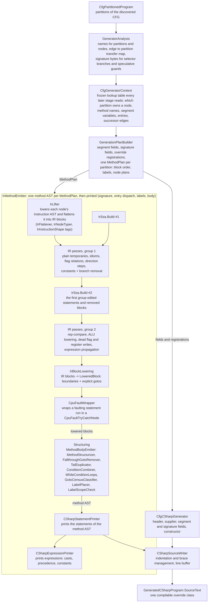

# C# Code Generator

Turns a discovered CFG (control flow graph) into a compilable C# override class that replaces the emulated assembly at runtime.

## What it does

After Spice86 runs a DOS program, it has a complete CFG of every instruction that executed. The generator takes that graph and produces a `.cs` file where each function partition becomes a C# method - gotos instead of jumps, method calls instead of `CALL`, typed register access instead of raw bytes.

## Pipeline overview

`CfgCSharpGenerator.Generate` runs these stages:



## Key concepts

### Partition = Method

The CFG is split into partitions (groups of blocks that form a logical function). Each partition becomes one C# method. Transfers between partitions become `return OtherMethod(loadOffset);`.

### Plan then write

The generator works in two phases:
1. **Plan** - decide everything up front (method order, labels, entry dispatch, segment fields)
2. **Write** - walk the plan and emit code mechanically, no re-analysis needed

The plan built by `GenerationPlanBuilder.Build` holds, per program: the segment fields, the override registrations and the signature fields (`SignatureFieldPlan`, one `private static readonly byte?[]` per instruction whose bytes are re-read at runtime). Per method (`MethodPlan`): a `BlockGraph<CfgBlock>` (`MethodPlan.BlockGraph`), a `DepthFirstOrdering<CfgBlock>` (`MethodPlan.BlockTraversal`), the block order, one `NodeEmissionPlan` per node (carrying `EmitsExternalEventCheck` and `EmitsExternalEventCheckAfter`), the label names and the local variable suffixes.

`IrMethodEmitter.Emit` then works over that plan like this:
1. lift the plan to an `IrMethod` (`IrLifter.Lift`): each node's instruction AST is lowered (`InstructionLowerer`, `TransferEmitter`, `CpuFaultWrapper` decide the same things as before) and flattened into IR blocks (`IrFlattener`), helper calls become typed nodes (`IrNodeTyper`), temporaries get their instruction-local suffix, the patterns printing needs are tagged (`IrInstructionShape`), and the lifted method is verified (`IrVerifier`);
2. run the first pass group on the first `IrSsa.Build`: `IrPlainTemporaryPropagation` and `IrInstructionIdioms` before the SSA, then `IrFlagPropagation`, `IrDirectionSteps`, `IrConstants` (the conditional constant propagation), `IrBranchSimplification` (constant arms removed, dead blocks dropped) and `IrJumpThreading` (trampoline blocks folded);
3. rebuild the SSA (`IrSsa.Build` a second time, on the new block structure) and run the second group on it: `IrRepCompareLowering`, `IrAluLowering`, `IrDeadFlagWrites`, `IrDeadRegisterWrites`, `IrExpressionPropagation` - see "Passes";
4. lower the IR blocks to `LoweredBlock<IrBlock>`s (`IrBlockLowering.Lower`: statements grouped into one `InstructionBoundaryNode` per same-origin run, terminator as explicit `goto`s, exit-only branch arms inlined), wrap each maximal fault-capable statement run in a `CpuFaultTryCatchNode`, and build the entry dispatch (`EntryDispatch.Build`);
5. structure the body with `MethodBodyEmitter.Structure`, the shared tail: `MethodStructurizer.Structure` twice (without and with loop exit placement, the fewer-gotos variant wins), `FallthroughGotoRemover`, `TailDuplicator`, `ConditionCombiner`, the goto census (`GotoCensusClassifier`), `WhileConditionLoops`, `LabelPlacer` and `LabelScopeCheck`;
6. print the method with `CSharpStatementPrinter`: the method variables first, the `entrydispatcher:` label when a `CyclicJumpNode` exists, the entry dispatch, the body.

`MethodBodyEmitter.Structure` throws `InvalidOperationException` when the method body can still complete normally (`CompletesNormallyVisitor`), because such a body would fall off its end.

### Block layout

Blocks are emitted in reverse post-order of a depth-first traversal that starts at the primary entry block (`GenerationPlanBuilder.BuildMethodPlan`). Successors are visited non-fallthrough first, in descending address order, and the fallthrough successor last (`GenerationPlanBuilder.LayoutSuccessors`), so the fallthrough block is usually placed right after its predecessor and needs no `goto`. The primary entry is always the first emitted node, so a single-entry method needs no jump at its start.

### Structuring

`MethodStructurizer.Structure` nests the lowered blocks into loops, conditionals and switch sections. Every transfer is still an explicit `goto` when it runs; the nesting only decides where the `goto`s can fall through or become `break` / `continue`.

- **Natural loops** - `NaturalLoopForest` finds the loops from the back edges of the block graph (a back edge targets a block that dominates its source). Every loop header must start with `CheckExternalEvents`, or `Structure` throws. A loop a second entry reaches is not structurable and stays `goto`.
- **`do` / `while (true)` loops** - a loop whose only latch ends with a conditional jump back to the header (its other arm leaving the loop) becomes a `do { ... } while (c)`; any other loop becomes `while (true)` and leaves through `break`. Child loops nest inside their parent's body.
- **`if` without `else`** - when one arm of a forward branch can be nested and comes back to the other arm's target, it nests under the condition and the `goto` back disappears.
- **`if` / `else`** - when both arms can be nested and share one common join, they nest as `if / else` and the `goto` to the join disappears.
- **Guard clauses** - when an arm diverges (none of its blocks has an exit inside the method: every path ends with `return`, `throw` or a transfer out of the method), it nests and the other arm stays flat, so `if (c) { ...; return X(); }` reads as a guard instead of a `goto`. When both arms diverge, only the arm whose head is later in the layout is nested; the earlier one stays flat.
- **Jump table `case` nesting** - the arms of a near jump table are nested in their `case` sections instead of jumping away.
- **Loop exit placement** - `Structure` also runs with `placeLoopExits`, which moves the exit block a loop's `goto`s target the most (with every unplaced block it dominates) right after the loop, so the `goto`s to it become `break`s. The emitter keeps whichever variant prints fewer `goto`s.
- **Fallthrough cleanup** - `FallthroughGotoRemover.Remove` then deletes every `goto` that jumps where control goes anyway: a `goto` to the next statement, a `goto` to what follows a `switch` section or a loop (`break;`), a `goto` to the start of a `while (true)` body (`continue;`), and a `goto` after a statement that never completes (unreachable).
- **Tail duplication** - `TailDuplicator.Apply` pastes a small diverging block at each of its `goto`s: at most 3 instruction boundaries, no local variable, no `goto` of its own, never completes normally, no partition entry, not a loop header. Every `goto` to a kept block is replaced, and the block's original statements are deleted when the statement before them never completes normally.
- **`while (c)` loops** - `WhileConditionLoops.Apply` turns a `while (true)` whose body holds only event checks and comments before a `if (c) { break; }` into `while (!c)` with the test removed. The event check then runs after the test instead of before it - a maintainer decision for readability: the check no longer runs before the test that leaves the loop, and a `continue;` tests the condition before the check.
- **`else if` printing** - `CSharpStatementPrinter` prints an `else` whose only statement is an `if` as `else if (c) { ... }` (far call dispatch reads as one chain).
- **De Morgan** - `CodeGenerationAst.NegatedCondition` distributes `!` over `&&` / `||`, so a negated exit condition prints as `CX == 0 || !ZeroFlag` rather than `!(CX != 0 && ZeroFlag)`.

Branches the structurizer refuses (a condition that reads a local, an arm head outside the region or already placed or a loop header or a loop latch, arms that never meet, a shared target) and irreducible regions (a backward target that does not dominate its source) stay `goto`.

### Goto census

`GotoCensusClassifier.Classify` assigns every printed `goto` exactly one `GotoKeepReason` and the test runner appends one line per generated program (fixture) to `generated-code/goto-census.txt`. The tests assert `total == gotos`: the census explains every `goto` of the printed source.

| reason | the goto survives because |
|---|---|
| `entryDispatch` | it is a `goto` of the entry dispatch `switch (loadOffset)` |
| `cyclicJump` | it is the `goto entrydispatcher;` of a cyclic cross-partition jump |
| `targetIsEntry` | its target block holds a partition entry |
| `loopWithSecondEntry` | its target sits in a natural loop a second entry reaches |
| `loopRestart` | its target is the header of the innermost enclosing structured loop |
| `loopExit` | its target is outside the innermost enclosing structured loop |
| `irreducible` | its target comes earlier in the layout and does not dominate it |
| `conditionReadsLocals` | a refused branch: its condition reads a local variable |
| `otherArmNotGoto` | a refused branch: the other arm is not a single `goto` |
| `armOutsideRegion` | a refused branch: the arm's head is outside the region being structured |
| `armHeadPlaced` | a refused branch: the arm's head is already placed |
| `armHeadIsLoopHeader` | a refused branch: the arm's head is a loop header |
| `armHoldsLatch` | a refused branch: the arm holds a latch of the enclosing loop |
| `armNeverComesBack` | a refused branch: the arm could nest but does not come back to the other target, and the other arm cannot nest |
| `noSingleJoin` | a refused branch: both arms could nest but have no single common exit, or both come back |
| `switchSection` | a `switch` section that was not nested |
| `sharedTarget` | its target is the target of two or more printed `goto`s of the method |
| `notNextInLayout` | none of the above: a `goto` to a block that does not follow in the layout |

### Method AST

One method is one AST. Its leaves are the instruction ASTs: the same runtime nodes the interpreter and the JIT use (`BlockNode`, `IfElseNode`, `WhileNode`, registers, memory, ALU calls, ...). Everything that only generated code needs is a code-generation node in `CfgCodeGeneration/Ast/`, visited through `ICodeGenerationAstVisitor<T>`:

| node | what it is |
|---|---|
| `InstructionBoundaryNode` | one CFG node: its event check, speculative guard, asm comment and lowered body; carries the local-variable suffix |
| `GotoNode` / `LabelNode` | a same-method jump to a block entry, and its label; the label text is resolved when printing |
| `EntryDispatcherLabelNode` / `CyclicJumpNode` | the `entrydispatcher:` label, and the cyclic cross-partition re-entry that jumps to it |
| `SwitchNode` / `SwitchSection` / `BreakNode` | entry dispatch and near runtime dispatch; the printer never adds `break;`, `CodeGenerationAst.Section` does |
| `InfiniteLoopNode` / `DoWhileNode` / `ContinueNode` | a `while (true)` loop built from a natural loop, a `do { ... } while (c)` loop, and the `continue;` restarting the innermost enclosing loop; the runtime `WhileNode` also prints the `while (c)` loops `WhileConditionLoops` builds |
| `ReturnNode` | `return` of an `Action`: `NearRet()`, `Hlt()`, `OtherMethod(0x0010)`, ... |
| `CpuFaultTryCatchNode` / `CpuFaultHandler` | the `try/catch (CpuException)` of an instruction that faulted during discovery |
| `TupleSwapNode` | a register swap printed `(BX, AX) = (AX, BX);` |
| `MethodScopedVariableReferenceNode` | a variable declared at method scope (`flagOperand_...`): prints without the instruction suffix and may move out of its boundary |
| `FailAsUntestedNode` / `UntestedMessagePart` | a `throw FailAsUntested(...)`; the holes of the message are expression nodes |
| `CheckExternalEventsNode`, `SpeculativeGuardNode`, `CommentNode`, `DivisionNode` | the helper calls and the comment of an instruction boundary, and the `Div16` / `IDiv16` tuple call |
| `SegmentVariableNode`, `OffsetLiteralNode`, `InstructionPointerNode`, `LoadOffsetParameterNode`, `MethodGroupNode`, `SignatureFieldNode`, `ExplicitCastNode` | expression leaves: `cs1`, `0x0010`, `IP`, `loadOffset`, a method group or a `_ => M(0x0004)` lambda, a `Signature_...` field, a cast |

Helper calls (`NearCall`, `InterruptCall`, `Callback`, `SelectorSignatureMatches`, ...) reuse the runtime `MethodCallNode` and `MethodCallValueNode`.

Completion rules (`CompletesNormallyVisitor`): a sequence follows its last statement; an `if` completes when one of its arms does; a `while` always completes; a `switch` completes when a section ends with `break` or its default completes; `return`, `goto`, `throw`, `FailAsUntested`, the cyclic jump and `break` never complete.

Rules for code that builds or walks the method AST:

- Lowered code is an `IVisitableAstNode`; "nothing" is an empty `BlockNode`. Build sequences with `CodeGenerationAst.Sequence`, which flattens nested `BlockNode`s, and test emptiness with `CodeGenerationAst.IsEmpty`.
- A lowered tree never contains runtime control-flow nodes (`JumpNearNode`, `CallNearNode`, `MoveIpNextNode`, ...). `CompletesNormallyVisitor` and `GotoTargetCollector` throw `InvalidOperationException` when they meet one.
- Instruction ASTs are shared with the interpreter and the JIT. A rewrite builds new nodes and never changes an existing one; returning an unchanged expression node is allowed because the nodes are immutable.
- A cast the generator adds is an `ExplicitCastNode`, which prints like `CSharpExpressionPrinter.Cast` and never folds constants. `TypeConversionNode` folds constants; it is only for conversions that come from the instruction AST.
- A new code-generation node is added to `ICodeGenerationAstVisitor<T>`, so every visitor (`CSharpExpressionPrinter`, `CompletesNormallyVisitor`, `GotoTargetCollector`) must decide what to do with it. `CSharpStatementPrinter` is a type switch: a new statement node needs its own case there.
- `CSharpStatementPrinter` and `CSharpExpressionPrinter` are the only producers of generated code text. No node holds generated code as a string; identifiers and comment text are not code.

### Edge lowering

Every jump/call/return in the original assembly becomes a "resolved CFG edge" - a source node, a target node, and metadata about what kind of transfer it is. The `TransferEmitter` turns each edge into the appropriate C# construct:

| Edge kind | Generated C# |
|-----------|-------------|
| Same method, next node | *(nothing - fallthrough)* |
| Same method, other node | `goto L_0009;` |
| Cross-partition | `return OtherMethod(0x0000);` |
| Cyclic cross-partition flow | `if (JumpDispatcher.Jump(unknown_F000_0025_F0025, 0x0000)) { loadOffset = JumpDispatcher.NextEntryAddress; goto entrydispatcher; }` then `return JumpDispatcher.RequiredJumpAsmReturn;` |
| Near/far call | `NearCall(cs1, 0x00CC, unknown_F000_0200_F0200);` / `FarCall(cs1, 0x000D, cs2, unknown_F100_0000_F1000);` plus the observed post-call continuation |
| Return | `return NearRet();` when the `ret` has no operand, `return NearRet(0x000A);` when it has one, `return FarRet();` for `retf` |

### The IR

One method is lifted to one `IrMethod` (`Ir/`): flat `IrBlock`s in layout order, each holding `IrStatement`s and ending in one `IrTerminator` (`IrJump`, `IrBranch`, `IrSwitch`, or an `IrExit` transfer out of the method - return, throw, `FailAsUntested`, cyclic jump). Blocks contain no `IfElseNode` / `WhileNode`: every explicit control-flow node of an instruction AST becomes blocks and edges, and only those - an ALU operation, a division, `CheckBound`, a bit scan stays one helper node.

- A statement keeps the `ICfgNode` it was lifted from (`IrStatement.Origin`): it gives the `// SEG:OFF asm` comment, the fault dispatch address and the census rows. An `IrEdge` between two blocks of the same origin is marked `InsideInstruction`; the others are CFG edges. `IrMethod.StructuralSuccessors` adds the edges an exit's origin can still fall through to, so the structurizer sees the same shape the old pipeline saw. `IrBlock.StartsInstruction` marks the first block of an instruction.
- Helper calls become typed nodes (`IrNodeTyper`): the typed CPU call nodes stay in the IR as they are (`StackCallNode`, `StackCallValueNode`, `PortReadCallNode`, `PortWriteCallNode`, `BoundCheckCallNode`, `BitScanCallNode`, the external-code helper nodes for `NearCall` / `FarCall` / `InterruptCall` / `Callback` / `CallbackMovedCsIp`, `SignatureMatchesHelperNode`), ALU calls become `AluOperationNode` / `AluStatementNode` with their flag effect, plus `DivisionNode`, `DirectionStepNode`, `CheckExternalEventsNode`, `SpeculativeGuardNode`, `InstructionStartNode`. A call the typer does not know makes the statement `OpaqueNode` with every effect.
- Temporaries get method-unique names (`flagOperand_<suffix>`, `equal_<suffix>`, method variables print before the body). The shapes the passes and the printing need (`rep cmps` / `rep scas`, division, `xchg`, `les` / `lds`) are tagged by the lifter (`IrInstructionShape`), never re-detected.
- `IrJumpThreading` removes trampoline blocks (an empty block jumping to one place) by forwarding their incoming edges; `IrBranchSimplification` removes the blocks a constant condition makes unreachable.

### Effects model

Every `IrStatement` and `IrTerminator` stores one `IrEffects` (`IrEffectsVisitor.Of` computes it once): `Reads`, `MustWrite`, `MayWrite` (over `IrValues`: register bytes, segment registers, the six status flags, the direction flag), `TokenReads`, `TokenWrites` (over `IrTokens`: `Memory`, `Io`), `MayFault`, `DeliversInterrupts`. `MayWrite` always includes `MustWrite`. Two constants cover the unknown: `IrEffects.Unknown` (an opaque statement) and `IrEffects.ExitUse` (a transfer out of the method uses every value). A statement that may fault is a possible exit. `DeliversInterrupts` marks the statements that can run a hardware interrupt handler: the event checks, `int`, `sti` / `popf` and the fault `catch`. The SSA, the liveness and every legality check read these fields; no pass keeps its own list of what an instruction may do.

### IR SSA

`IrSsa` (`Ir/Ssa/`) is a sparse analysis-only side table over the `IrSsaValue`s: the whole 32-bit general registers (a sub-register write is a *partial definition* reading the previous version), the segment registers, the six status flags, the direction flag, and the two tokens `Memory` and `Io` (a token write is always partial, so side effects keep their order). Versions are recorded per definition and per use from the stored effects; phis are placed at the iterated dominance frontiers of the block graph (the classic construction, `ToBlockGraph` - no structural edges). `VersionBefore` / `VersionAfter` answer "which version a position sees", `VersionUsed` / `Definitions` the sites of one statement, `LiveUses` the uses a version still feeds (dead phi operands and dead carried bytes do not count), `IsLive` one version's liveness. A pass that edits statements keeps the table honest: `IrSsa.Replace` moves the recorded site to the replacement (and throws when the replacement defines a machine value the old statement did not), `IrSsa.Remove` drops a removed statement; an inserted statement that defines a machine value without a site makes the version queries throw. `IrSsaWebs` unions the versions that must share one storage place (a full low-16 write cuts the web). `SameVersions(reads, tokens, from, to)` is the one legality rule every pass shares: an expression may move or merge between two places when every value it reads, tokens included, has the same version at both.

### Passes

In `IrMethodEmitter.Emit` order; the SSA is built once before group 1 and rebuilt once after `IrBranchSimplification`, because the first group edits statements and removes blocks.

| pass | what it does |
|---|---|
| `IrPlainTemporaryPropagation` | inlines a `VariableDeclarationNode` whose initializer has no memory access, call or variable into its same-block reads and drops the declaration |
| `IrInstructionIdioms` | `xchg` of two registers prints `(BX, AX) = (AX, BX)`; a `les` / `lds` pair prints two direct assignments |
| `IrFlagPropagation` | a `jcc` prints the relation of the ALU setter defining every flag version it reads (`FlagRelationRules` gives the relation); a carry reader gets the setter's carry relation; a memory operand the relation cannot read twice goes through a `flagOperand_` temporary; a setter with no live flag use is dropped |
| `IrDirectionSteps` | a lattice over the direction versions gives the direction where every path agrees; a `DirectionStepNode` there prints `SI += n` / `DI -= n` |
| `IrConstants` | sparse conditional constant propagation: per-byte lattice of the general-register versions, executable-edge analysis, a "clean" mask per position (no interrupt delivery, unknown effect or method entry since the definition); substitutes the constant reads (`IrConstantFacts`), removes dead declarations, folds identities |
| `IrBranchSimplification` | boolean identities on `IrBranch` conditions, a constant condition becomes an `IrJump`, unreachable blocks are removed; returns the removed counts (`BranchRemovalCensus`) |
| `IrJumpThreading` | folds empty jump blocks into their predecessors' edges |
| `IrRepCompareLowering` | a `repe` / `repne` `cmps` / `scas` whose `AluN.Sub` feeds no live flag but the exit latch compares the operands directly (`equal_<suffix>`) |
| `IrAluLowering` | the `AluAssignmentRewrite` port: an unused ALU call is removed, an assignment expands to plain operators with the flag writes still needed, by `IrFlagLiveness` |
| `IrDeadFlagWrites` | a `clc` / `stc` / `cmc` / `sahf` whose flag version is dead is removed |
| `IrDeadRegisterWrites` | a plain register write whose defined versions are all dead is removed; a use that only carries bytes a later write overwrites does not keep it |
| `IrExpressionPropagation` | a plain assignment read exactly once is merged into its reader, bounded in size and chain length; the legality check is `SameVersions` |

The legality conditions are catalogued in [codeGeneratorLegality.md](codeGeneratorLegality.md) with the mutation evidence; the mapping to the IR passes:

| catalogue rows | now implemented by | trapped by (ASM fixture sections) |
|---|---|---|
| ConstantReadRewrite CR-1 to CR-8 | `IrConstants.Substitute` (`Rewrite`, the LHS and segment/ESP refusals, the call-argument scope, the same-instruction kill) | `dataflow_legality_traps` §CR-2; compile gate (CR-6); the rest redundant or unreachable there too |
| RegisterConstants RC-1 to RC-6 | `IrConstants.ComputeLattice` / `Meet` / clean analysis | `dataflow_legality_traps` §RC-phi, §RC-4; `dataflow_constant_folding`, `dataflow_partial_registers`, `externalint.pit`, `stipending.pit`, `opl_read_delay.pit.a20.ivt.opl3` |
| PlainTemporaryPropagation PT-1 to PT-3 | `IrPlainTemporaryPropagation` | `dataflow_legality_traps` §PT-1; `dataflow_partial_registers`, `dataflow_idioms`, `instruction_coverage_386` |
| FlagPropagation / FlagReadSubstitution FP-1 to FP-8 | `IrFlagPropagation` (and `FlagReadSubstitution` for the carry reader) | `dataflow_legality_traps` §FP-1, §FP-4; `dataflow_flag_definitions`, `alu_dead_flags`, `dataflow_double_precision`, `dataflow_expression_propagation` |
| DirectionStepRewrite / DirectionFlagValues DS-1 to DS-3 | `IrDirectionSteps` | `dataflow_interrupt_boundaries.pit` |
| DeadRegisterWrites DW-1 to DW-5 | `IrDeadRegisterWrites` | `dataflow_legality_traps` §DW-1, §DW-3; live-version fixtures |
| AluAssignmentRewrite AA-1 to AA-4 | `IrAluLowering` | `dataflow_legality_traps` §AA-4; `dataflow_flag_definitions`, `instruction_coverage_386`; compile gate |
| IrDeadFlagWrites DF-1 to DF-2 | `IrDeadFlagWrites` | `alu_dead_flags`, `bcdcnv`, `datatrnf`, `dataflow_double_precision`, `dataflow_flag_definitions`, `instruction_coverage_386`, `realloc_test_pad*` |
| ExpressionPropagation EP-1 to EP-8 | `IrExpressionPropagation` (`SameVersions` covers EP-1; the memory/port scan covers EP-5) | `dataflow_legality_traps` §EP-1, §EP-5, §EP-7b; `IrExpressionPropagationTest` for the port half of EP-5 |
| InstructionIdioms ID-1 to ID-2 | `IrInstructionIdioms` | `dataflow_legality_traps` §ID-2 |
| ConditionCombiner CC-1 to CC-3 | `Ast/ConditionCombiner` (unchanged, runs after structuring) | `dataflow_rewrite_traps` §§3-4 |
| SSA boundary rules SSA-1 to SSA-7 | the effects model + `IrSsa` (`ExitUse` transfers, mid-block entries, partial definitions) + the `IrConstants` clean mask | `dataflow_interrupt_boundaries.pit`, `dataflow_partial_registers`, `externalint.pit`, `stipending.pit` |

### How to add a pass

A pass is an `IrMethod` -> `IrMethod` transform in the fixed list of `IrMethodEmitter.Emit`. To add one:

1. state each legality condition with the effects model in the pass's summary (what it may read, write, move or drop, in `IrValues` / `IrTokens` / `MayFault` / `DeliversInterrupts` terms; `SameVersions` is the move/merge rule);
2. add one ASM fixture section per condition whose result region fails when the condition is dropped (a mutation check); `dataflow_legality_traps` shows the pattern;
3. update or remove the statements through `IrSsa.Replace` / `IrSsa.Remove` so later passes in the same group keep working; if the pass changes the block structure (removes or adds blocks/edges), it must run before the SSA rebuild or trigger one;
4. run the opt-in runs: the generated-code classes serially (goldens) and `SPICE86_JIT_GENERATOR_IR=1`.

### Opt-in runs

- `SPICE86_JIT_GENERATOR_IR=1 dotnet test tests/Spice86.Tests` (or the `--JitGeneratorIr` command-line option): the JIT executes each instruction's execution AST after the IR round trip (`GeneratorIrRoundTrip`: an instruction's IR is structured back into `IfElseNode` / `WhileNode` trees and printed as a CPU AST). `SingleStepTest` is included. This is the check that the lifter keeps the CPU semantics, not a normal test run.
- `SPICE86_GENERATED_CODE_COVERAGE` / `SPICE86_GENERATED_CODE_PROBES`: the generator audit tools, see `AGENTS.md`.

- **Compound assignment** (`CSharpStatementPrinter`): `X = X op e` prints `X op= e` when `X` and the operand are simple (registers, constants, conversions, pure binaries, resolved instruction fields).
- **Printer casts and folds** (`CSharpExpressionPrinter`): inside `>>`, `/`, `%` and the comparisons, a promoted operand whose value may exceed its width is cast back to its type (`(ushort)(BX + 1) >> 1`); operands that cannot exceed (`x & 0xFF`, registers, memory reads) print bare. Constant terms fold modulo the width (`x - 0x18 + 2` prints `x - 0x0016`), a binary of two constants prints its value, shift counts print decimal, and same-width sign round-trips (`(ushort)(short)x`) and casts into an already-typed fragment are elided.

### Accepted equivalences

- `CheckExternalEvents` is the only place a pending hardware interrupt is delivered (see "External event checks"), and every analysis assumes the handler preserves registers and flags - except register constants, which never cross a check, because a real handler may write any register (a timer handler in the PIT fixtures writes `DX`). A pending interrupt is also delivered one instruction earlier than a real CPU would deliver it after `sti` / `popf` / `popfd`, because `State.InterruptShadowing` is not emitted.
- Rejected equivalence: collapsing `push X; pop Y` into `Y = X` is *not* done. The popped word below `SP` stays observable: `datatrnf` reads it through a different segment:offset alias (`les` at `F000:0054` reads linear `0x57985` = `SS:0005`, the word `push es` wrote and `popf` abandoned), so dropping the `push` is unsound in a way no local check can fix.

### External event checks

`CheckExternalEvents(cs, ip)` tells the emulator to deliver pending interrupts and advance emulated time. It is emitted in exactly three places:

1. at the entry of every method entry block; for an entry that sits in the middle of a block, inside its `switch (loadOffset)` case, before the `goto` (`EntryDispatch.Build`);
2. at the entry of every block that is the target of a retreating edge of the layout traversal (loop heads), so every repeating path passes a check; when the structurizer gathers the blocks into a loop, this check is the first statement of the loop body;
3. after the body of an instruction that may enable interrupts (`sti`, `popf`, `popfd`), detected on the instruction AST by `InterruptEnableDetectorVisitor` (`sahf` does not count), unless its fallthrough block already checks at its entry.

The two flags that decide this are precomputed per node in `GenerationPlanBuilder.BuildMethodPlan` as `NodeEmissionPlan.EmitsExternalEventCheck` and `NodeEmissionPlan.EmitsExternalEventCheckAfter`. Straight-line code that has none of these three points gets no check, on purpose: emulated time only matters in loops.

Generated code never emits `State.InterruptShadowing`: the interpreter sets it so delivery waits one instruction after `sti`, but the generated `CheckExternalEvents` never reads it, so the lifter drops the assignment. Known deviation: a pending interrupt is then delivered at the check right after `sti` / `popf` / `popfd`, one instruction earlier than a real CPU would deliver it.

### Helpers used by generated code

The generated class derives from `CSharpOverrideHelper`, which provides:

- `DispatchCpuFault(cpuException, cs, ip, [new CpuFaultTarget(...)])` in the `catch` of a faulting instruction;
- `Div8` / `Div16` / `Div32` / `IDiv8` / `IDiv16` / `IDiv32`, each returning `(Quotient, Remainder)`, for example `(AX, DX) = Div16(divisor: CX, dividend: ...);`;
- `In8` / `In16` / `In32` and `Out8` / `Out16` / `Out32` for port I/O;
- `SelectorSignatureMatches` and `VerifySpeculativeEntryOrFail`, which read the `Signature_...` fields;
- `FailAsUntested`, which throws on a path discovery never observed;
- `CheckExternalEvents`, the delivery point described above.

### Naming

Labels are `L_<offset>` (for example `L_0003`), unique per method; the node id is appended only when two nodes of the method share an offset (self-modifying code). Temps use the instruction offset as suffix, per method, with the same collision rule (for example `popDestinationCheck_0073`). Signature fields are `private static readonly byte?[] Signature_<offset>_<mnemonic>` (for example `Signature_0019_jne`), one per instruction, same collision rule. The mnemonic comes from `InstructionMnemonic`, and the collision rule itself is `DisambiguatedNames.Build`, called from `GenerationPlanBuilder` for labels and local suffixes and from `GeneratorAnalysis` for signature fields. Every `FailAsUntestedNode` comes from `UntestedMessages`, one method per kind: `Jump`, `ConditionalFallthrough`, `FallthroughAfter`, `IndirectWithoutTargets`, `NearTarget`, `FarTarget`, `CodeVariant`, `CallbackTarget`, `ReturnFromCall`, `EntryOffset`.

### Untested paths

If an edge was never traversed during discovery, the generated code throws `FailAsUntested(...)` at that point. This makes it safe to run the generated code: it either does exactly what was observed, or fails loudly on an unobserved path. Generated code expects speculative discovery to have filled the gaps: a conditional arm without a CFG edge fails as untested, and a `VerifySpeculativeEntryOrFail` guard re-reads the bytes of each speculative instruction before it runs.

A far call whose target was observed is dispatched on the remembered segment/offset pair: the generated code prints an `if` / `else if` chain over the observed targets (one `FarCall` per pair), the continuation is emitted once after the chain, and the final `else` fails as untested.

### CPU fault handling

Instructions that triggered a hardware exception (e.g. divide by zero) during discovery get wrapped in `try/catch(CpuException)`. The `catch` calls `DispatchCpuFault(cpuException, cs, ip, [new CpuFaultTarget(...)])`, which reads the live IVT, matches the handler, performs the fault entry sequence (push flags, push return address, clear interrupts, set CS/IP) and invokes the handler partition.

### Self-modifying code

Instructions at the same address with different bytes (self-modifying code) are handled through selector nodes. The generated code checks which byte signature currently matches memory and branches to the corresponding variant.

## Reusable analyses

Use these before writing a new traversal, graph or naming helper:

| type | location | what it gives |
|---|---|---|
| `BlockGraph<TBlock>` and `CfgBlockGraphs` | `ControlFlowGraph/Analysis/` | blocks, entries, successors, predecessors and fallthrough successor of a graph, generic over the block type |
| `DominatorTree<T>` / `DominatorTreeBuilder` and `DominanceFrontiers` | `ControlFlowGraph/Analysis/` | dominator tree and dominance frontiers of any block graph |
| `NaturalLoopForest<T>` / `NaturalLoop<T>` | `ControlFlowGraph/Analysis/` | the natural loops of a graph from its retreating edges and dominator tree |
| `ForwardDataflowSolver` and `BackwardDataflowSolver` | `ControlFlowGraph/Analysis/` | fixpoint in/out values over the blocks of one graph, per direction |
| `DepthFirstOrdering<T>` and `GraphEdge<T>` | `Graph/` | post-order, reverse post-order and retreating edges for any successor function |
| `CodeGenerationAst`, `CompletesNormallyVisitor`, `GotoTargetCollector` | `CfgCodeGeneration/Ast/` | statement sequences and switch sections, completion analysis and goto targets of a lowered tree |
| `InterruptEnableDetectorVisitor` / `StatementPredicateVisitor` | `CPU/CfgCpu/Ast/Visitor/` | boolean predicates over an instruction AST, searching statement containers recursively |
| `DisambiguatedNames` and `InstructionMnemonic` | `CfgCodeGeneration/Naming/` | collision-free names from a base name plus a suffix; an instruction mnemonic as an identifier token |
| `IrEffects` and `IrEffectsVisitor` | `CfgCodeGeneration/Ir/` | the stored effects of a statement or terminator (see "Effects model") |
| `IrSsa` and `IrSsaWebs` | `CfgCodeGeneration/Ir/Ssa/` | sparse versions of the machine values and tokens (see "IR SSA") and their sharing webs |
| `FlagRelationRules` and `FlagSetter` | `CfgCodeGeneration/Relations/` | the operand relation a `BuildSetCondition` code means after an ALU setter, and which setter produced a flag version |
| `ConstantEvaluation` | `CfgCodeGeneration/Propagation/` | folds all-constant AST nodes to one `ConstantNode` |

The dependency rule is `CfgCodeGeneration -> ControlFlowGraph.Analysis -> Graph`, never the other way: nothing under `Graph` or `ControlFlowGraph.Analysis` may reference `MethodPlan`, `NodeEmissionPlan` or anything else under `CfgCodeGeneration`.

## File layout

```
CfgCodeGeneration/
|-- AluAssignmentRewrite.cs         expands a one-ALU-call statement into plain code (used by IrAluLowering)
|-- BranchRemovalCensus.cs          the removed branch / block counts of one method
|-- CfgCSharpDumper.cs              writes the generated override file to the recording directory
|-- CfgCSharpGenerator.cs           top-level orchestrator: analyze -> plan -> emit methods -> print
|-- CfgGeneratorContext.cs          frozen lookup table shared by every stage
|-- CpuFaultSuccessors.cs           the fault edges of an instruction
|-- CpuFaultWrapper.cs              wraps a faulting statement run in a CpuFaultTryCatchNode
|-- CSharpExpressionPrinter.cs      prints expression nodes as C# fragments: casts, precedence, constants
|-- CSharpSourceWriter.cs           indentation, braces and line buffer
|-- CSharpStatementPrinter.cs       prints a method AST as C# statements
|-- DivisionPattern.cs              the DIV/IDIV statement shape the lifter tags
|-- EntryDispatch.cs                the method entry dispatch switch
|-- GeneratedProjectScaffolder.cs   csproj + Program.cs scaffold for a runnable project
|-- GenerationPlanBuilder.cs        builds the plan (fields, registrations, per-method plans)
|-- GeneratorAnalysis.cs            first pass: names, transfers, signature bytes
|-- InstructionBoundary.cs          the boundary statements a node emits (check, guard, start)
|-- InstructionLowerer.cs           lowers an instruction AST for code generation
|-- MethodBodyEmitter.cs            the shared structuring tail (see "Plan then write", step 5)
|-- MethodCensus.cs                 the goto / flag-read / web counts of one method
|-- TransferEmitter.cs              lowers one CFG edge to goto / return / dispatcher / call nodes
|-- UntestedMessages.cs             the FailAsUntested nodes, one per untested situation
|-- Ast/
|   |-- ICodeGenerationAstVisitor.cs    visitor over runtime and code-generation nodes
|   |-- CodeGenerationAst.cs            Sequence / Empty / IsEmpty / Section helpers, NegatedCondition
|   |-- CompletesNormallyVisitor.cs     completion analysis of a lowered tree
|   |-- ConditionCombiner.cs            folds nested ifs and same-exit ifs into && / || conditions
|   |-- FallthroughGotoRemover.cs       deletes gotos that jump where control goes anyway
|   |-- GotoTargetCollector.cs          goto targets of a lowered tree
|   |-- GotoTargets.cs                  target labels + entry dispatcher flag
|   |-- LabelPlacer.cs                  puts one LabelNode before the statement each goto target starts at
|   |-- LabelScopeCheck.cs              verifies every goto's label is visible where the goto prints
|   |-- LoopExits.cs                    whether a statement holds a break / continue an inner construct would capture
|   |-- WhileConditionLoops.cs          turns a while (true) with an exit test first into while (c)
|   `-- *Node.cs, SwitchSection.cs, CpuFaultHandler.cs, UntestedMessagePart.cs
|                                       the code-generation nodes (see "Method AST" and "The IR")
|-- Ir/
|   |-- IrLifter.cs                 MethodPlan -> IrMethod; the only code that reads CPU AST shapes
|   |-- IrFlattener.cs              one instruction AST -> IR blocks (explicit control flow only)
|   |-- IrNodeTyper.cs              helper calls -> typed nodes, temporaries renamed
|   |-- IrMethod.cs                 the lifted method: blocks, entries, structural successors
|   |-- IrBlock.cs / IrStatement.cs / IrTerminator.cs / IrEdge.cs
|   |                               the flat blocks, statements, terminators and edges
|   |-- IrJump.cs / IrBranch.cs / IrSwitch.cs / IrExit.cs / IrSwitchCase.cs / IrEntry.cs
|   |                               the terminator and entry kinds
|   |-- IrEffects.cs / IrEffectsVisitor.cs / IrValues.cs / IrTokens.cs / IrValueSets.cs
|   |                               the stored effects model (see "Effects model")
|   |-- IrBlockLowering.cs          IR blocks -> LoweredBlock<IrBlock>s (boundaries + gotos)
|   |-- IrJumpThreading.cs          folds empty jump blocks into their predecessors' edges
|   |-- IrInstructionShape.cs       the instruction shapes the lifter tags
|   |-- IrMethodEmitter.cs          builds one method AST per method, then prints it
|   |-- IrVerifier.cs               the IR invariants (checked when the generator is built with verify)
|   |-- IrAstChildren.cs            the children of an IR AST node
|   |-- IrDumper.cs                 prints an IrMethod for debugging
|   |-- IrFlagReadCensusClassifier.cs / IrWebCensusClassifier.cs
|   |                               the flag-read and web censuses (only when collected)
|   |-- GeneratorIrRoundTrip.cs     an instruction's IR back to a CPU AST (the JIT opt-in)
|   |-- LiftedMethod.cs             the lifted result of one method
|   |-- Passes/
|   |   `-- Ir*.cs                  the passes of "Passes", in Emit order
|   `-- Ssa/
|       |-- IrSsa.cs                the sparse SSA (see "IR SSA")
|       |-- IrSsaWebs.cs            the versions that share one storage place
|       |-- IrSsaValue(s).cs        the tracked values and their sets
|       |-- IrSsaPhi.cs / IrSsaUse.cs / IrSsaVersionInfo.cs / IrSsaDefinitionKind.cs
|       |                           the side-table records
|       `-- IrTemporaries.cs        the method temporaries
|-- Structuring/
|   |-- MethodStructurizer.cs       nests the lowered blocks into loops, ifs and switch sections
|   |-- LoweredBlock.cs             the contiguous boundaries of one block, in layout order
|   |-- TailDuplicator.cs           pastes a small diverging block at each of its gotos
|   |-- GotoCensusClassifier.cs     one GotoKeepReason per printed goto
|   |-- GotoCensus.cs               the per-method goto counts
|   `-- GotoKeepReason.cs           why a goto survives structuring (see "Goto census")
|-- Ssa/
|   |-- FlagReadCensus.cs           per-reason counts of the printed flag reads
|   |-- FlagSetterKind.cs / FlagSetterDistance.cs / FlagPropagationBlocker.cs
|   |                               what produced a flag version and why a read cannot inline it
|   `-- WebCensus.cs                how register webs would fare as C# locals
|-- Propagation/
|   |-- ConstantEvaluation.cs       folds all-constant AST nodes to one ConstantNode
|   |-- DirectionStepRewrite.cs     the direction-step expression IrDirectionSteps rewrites
|   `-- FlagReadSubstitution.cs     the carry-relation substitution IrFlagPropagation applies
|-- Relations/
|   |-- FlagRelationRules.cs        the operand relation a flag condition code means
|   |-- FlagRelationOperands.cs     the operands a relation is built from
|   `-- FlagSetter.cs               which ALU setter shape produced a flag version
|-- Model/
|   |-- CallContinuation.cs         expected return address + observed post-call edge
|   |-- CSharpFragment.cs           a printed expression with its type and precedence
|   |-- GeneratedCSharpProgram.cs   the produced source text + censuses
|   |-- GeneratedOverrideNames.cs   namespace, class and file names baked into the output
|   |-- ResolvedCfgEdge.cs          a source/target edge with its successor kind
|   `-- Plan/
|       |-- GenerationPlan.cs       segment fields, signature fields, registrations, methods
|       |-- MethodPlan.cs           one method: blocks, nodes, labels, traversal, entry dispatch
|       |-- NodeEmissionPlan.cs     per-node emission decisions
|       |-- OverrideRegistration.cs one DefineFunctionWithoutInterpreterFallback registration
|       |-- SegmentFieldPlan.cs     one segment field declaration
|       `-- SignatureFieldPlan.cs   one byte?[] signature field
`-- Naming/
    |-- DisambiguatedNames.cs       base name + suffix disambiguation
    `-- InstructionMnemonic.cs      instruction mnemonic as an identifier token
```
