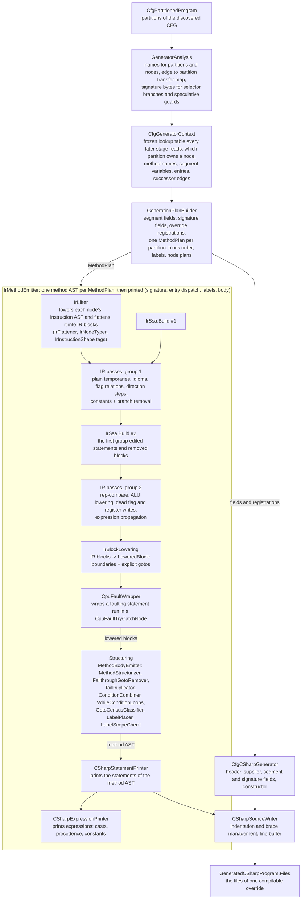

# C# Code Generator

Turns a discovered CFG (control flow graph) into a compilable C# override class that replaces the emulated assembly at runtime.

## What it does

After Spice86 runs a DOS program, it has a complete CFG of every instruction that executed. The generator takes that graph and produces a set of `.cs` files where each function partition becomes a C# method - gotos instead of jumps, method calls instead of `CALL`, typed register access instead of raw bytes.

## Non-goals

Generated C# is not expected to trigger emulator or debugger breakpoints. Matching the interpreter's breakpoint delivery, count, order or debugger-visible register snapshots is not a correctness requirement. Diagnostic bookkeeping such as the dispatcher's last-port fields is also outside the generated-code contract.

Do not add wrappers, dispatcher calls or tests solely to preserve breakpoint notifications. A device operation, including a recognized packed VGA word write, may bypass that bookkeeping when it preserves the behavior the emulated program depends on.

This does not relax program semantics: required register and flag results, memory and device effects, hardware interrupts and scheduled events still matter. Existing checks may remain, but their presence does not create a breakpoint-parity guarantee.

## Pipeline overview

`CfgCSharpGenerator.Generate` runs these stages:



## Key concepts

### Partition = Method

The CFG is split into partitions (groups of blocks that form a logical function). Each partition becomes one C# method. Transfers between partitions become `return OtherMethod(loadOffset);`.

A partition with a single entry has no `loadOffset` to dispatch on: its method prints `public virtual Action M()` (no entry `switch`, no `loadOffset` parameter). Every reference to it goes through `Entry(M)`, a `CSharpOverrideHelper` cache that returns one `Func<int, Action>` per method group: `DefineFunctionWithoutInterpreterFallback` gets a stable delegate identity, and call/cyclic-jump sites pass `Entry(M)` where a callee delegate is expected. A `return M();` tail transfer is exact because the typed method performs the return itself (`NearReturn` / `FarReturn` pop the stacked return address) and returns `Returned`, a no-op `Action`. Multi-entry partitions keep the `Action M(int loadOffset)` signature and are referenced as `M` or `_ => M(0x0004)` for a secondary entry.

### Typed signatures

A single-entry method whose every return exit is a near or far `ret`/`retf` gets a signature built from its calling-convention sets (`IrCallingConventions`): inputs become parameters, outputs become the return value - `void` when empty, one scalar otherwise, a tuple when several. Registers print by their 16-bit name (`ax`), segment registers and 32-bit values in full (`ds`, `eax`), flags as `bool` (`carryFlag`). Register reads still at their method-entry version print the parameter name instead of `AX` (a narrower read of the same version gets a cast, `(byte)ax`); a register that is reassigned or first written in the body keeps printing `AX`; the substitution is only a name, never applied to an assignment target. Typed parameters come from the calling convention, including inputs read through machine state. The method body first assigns each parameter to its register. Every explicit or implicit read then sees the supplied argument. Generated callers pass the live registers; direct C# callers and subclasses may supply different values. A return exit prints `NearReturn(popBytes)` / `FarReturn(popBytes)` - the parameterless `NearReturn()` / `FarReturn()` for a plain `ret`/`retf` - (the stacked return address is popped by the callee, exactly like the helper-returning code does) and then `return (<outputs>);`.

The typed method is never referenced as a delegate: an `Action`-shaped `<Name>_Asm` wrapper printed right after it calls it with the current registers, stores the outputs back, and returns `Returned`. Registration, untyped call sites, cyclic jumps, CPU fault targets and partition returns (`return <Name>_Asm();`) all point at the wrapper, so generated code always enters the typed method with live registers and the real machine stack.

A call site to a typed method prints the typed call form - `(AX, CarryFlag) = NearCall(biosSegment, 0x0303, () => callee(EAX, DS));` - only when the call has a single observed target that is the typed method's entry, an observed continuation, and no redirected return. The helper pushes the expected return address, runs the callee and requires CS:IP to be that address afterwards; a callee that returns somewhere else throws `CallStackUnwindException`, which an outer call frame expecting that address consumes - the same unwind an untyped call performs, so a typed call on an unwinding path is still safe. Call sites that can observe a redirected return keep the `...ReturnedElsewhere` helpers and stay untyped. A typed call site names the method's own entry point, so it runs that exact C# method: an address-based override registered for the same address (a second `IOverrideSupplier`, a `DefineFunction`) is not reached - only a subclass `override` of the `virtual` method replaces it.

### Plan then write

The generator works in two phases:
1. **Plan** - decide everything up front (method order, labels, entry dispatch, segment fields)
2. **Write** - walk the plan and emit code mechanically, no re-analysis needed

The plan built by `GenerationPlanBuilder.Build` holds, per program: the segment fields, the override registrations and the signature fields (`SignatureFieldPlan`, one `private static readonly byte?[]` per instruction whose bytes are re-read at runtime). Per method (`MethodPlan`): a `BlockGraph<CfgBlock>` (`MethodPlan.BlockGraph`), a `DepthFirstOrdering<CfgBlock>` (`MethodPlan.BlockTraversal`), the block order, one `NodeEmissionPlan` per node (carrying `EmitsExternalEventCheck` and `EmitsExternalEventCheckAfter`), the label names and the local variable suffixes.

`IrMethodEmitter.Emit` then works over that plan like this:
1. lift the plan to an `IrMethod` (`IrLifter.Lift`): each node's instruction AST is lowered (`InstructionLowerer`, `TransferEmitter`, `CpuFaultWrapper` decide the same things as before) and flattened into IR blocks (`IrFlattener`), helper calls become typed nodes (`IrNodeTyper`), temporaries get their instruction-local suffix, the patterns printing needs are tagged (`IrInstructionShape`), and the lifted method is verified (`IrVerifier`);
2. run the first pass group on the first `IrSsa.Build`: `IrPlainTemporaryPropagation` and `IrInstructionIdioms` before the SSA, then `IrFlagPropagation`, `IrDirectionSteps`, `IrConstants` (the conditional constant propagation), `IrInterruptServiceCalls` (`int` sites on a vector the whole program kept bound to the built-in stub, with a known selector bound to a declared implementation, become direct calls assigning the returned outputs straight into their register/flag lvalues; when it replaced a statement the SSA is rebuilt and `IrConstants` runs a second time, so `IrBranchSimplification` folds across the calls), `IrBranchSimplification` (constant arms removed, dead blocks dropped), `IrIfConversion` (an instruction's two-arm value choice becomes one `x = c ? a : b`) and `IrJumpThreading` (trampoline blocks folded);
3. rebuild the SSA (`IrSsa.Build` a second time, on the new block structure) and run the second group on it: `IrRepCompareLowering`, `IrAluLowering`, `IrDeadFlagWrites`, `IrStoreForwarding`, `IrDeadRegisterWrites`, `IrExpressionPropagation`, the additive constant fold (`IrConstantFolder.FoldAdditiveConstants`), `IrDeviceOperations` (a recognized port-access sequence in one block becomes the device operation it performs: `Cmos.ReadRegister` / `WriteRegister`, `Pit.ProgramChannel`, `Vga.SetPaletteEntry` / `WriteSequencerRegister` / `WriteGraphicsControllerRegister`, `Opl.WriteRegister`), `IrDoublePrecision` (a register pair's `add`/`adc`-style instruction sequence becomes one operation on the combined wide value) and `IrSpeculativeGuardMerge` - see "Passes";
4. lower the IR blocks to `LoweredBlock<IrBlock>`s (`IrBlockLowering.Lower`: statements grouped into one `InstructionBoundaryNode` per same-origin run, terminator as explicit `goto`s, exit-only branch arms inlined), wrap each maximal fault-capable statement run in a `CpuFaultTryCatchNode`, and build the entry dispatch (`EntryDispatch.Build`);
5. structure the body with `MethodBodyEmitter.Structure`, the shared tail: `MethodStructurizer.Structure` twice (without and with loop exit placement, the fewer-gotos variant wins), `FallthroughGotoRemover`, `TailDuplicator`, `ConditionCombiner`, the goto census (`GotoCensusClassifier`), `WhileConditionLoops`, `LabelPlacer` and `LabelScopeCheck`;
6. print the method with `CSharpStatementPrinter`: the method variables first, the `entrydispatcher:` label when a `CyclicJumpNode` exists, the entry dispatch, the body.

`MethodBodyEmitter.Structure` throws `InvalidOperationException` when the method body can still complete normally (`CompletesNormallyVisitor`), because such a body would fall off its end.

### Generated files

The output is a list of `GeneratedSourceFile`s (name + text), not one big source string:

- `CfgGeneratedOverrideSupplier.cs`: the `IOverrideSupplier` class.
- `CfgGeneratedOverrides.cs`: `public partial class CfgGeneratedOverrides : CSharpOverrideHelper` with the segment fields, the signature fields and the constructor.
- `CfgGeneratedOverrides.<SSSS>.cs`: the methods whose primary entry lives in segment `SSSS` (4-digit hex), segments ascending, methods in plan order inside a segment - more `partial` declarations of the override class. A segment file over `CfgCSharpGenerator.MaxLinesPerFile` (4000) printed lines splits at method boundaries into `.1.cs`, `.2.cs`, ...; a method is never split.
- `DsGlobals.cs` / `EsGlobals.cs` / `CsGlobals.cs` / `FsGlobals.cs` / `GsGlobals.cs`: one file per segment register the program accesses at constant offsets, in that order (see "Globals").

`CfgCSharpDumper.Write` writes the files into the `spice86dumpCfgGeneratedOverrides` directory of the dump folder; `WriteProject` writes them next to the generated csproj and deletes a legacy single `CfgGeneratedOverrides.cs` (an earlier scaffolder wrote the whole program there). `GeneratedCSharpProgram.SourceText` is the golden form the tests compare: the files concatenated in order, each preceded by a `// ==== file: <name> ====` marker line and separated by one empty line. Every method starts with a `///` doc comment naming the machine values its entries input, output and change (the `IrCallingConventions` sets, see "Reusable analyses").

### Segment fields

The generated class declares one `protected readonly ushort` field per distinct code segment the program was observed at and initializes them in the constructor (`SegmentFieldPlan.BuildAll`). The constructor receives `programStartSegment` - the segment right after the program's PSP, passed down from `configuration.ProgramEntryPointSegment` - so a segment inside any DOS-loaded image gets an initializer relative to it (`cs1 = (ushort)(programStartSegment - 0x0010);`, bare `programStartSegment` when the difference is 0) and the generated class still resolves its code segments when the programs are loaded elsewhere. Every image the loaders write is recorded by `DosProcessManager`, `BiosLoader` and `PCBootLoader` in the `LoadedImageRegistry` (`LoadedImage`: kind, name, first segment, start address and size in bytes): the initial program, programs the batch launches afterwards, EXEC children and overlays all count as inside. A `.bin` loaded at `F000` or a boot sector has no DOS-loaded image and keeps observed values. The assumption is that DOS loads every image at the same distance from `programStartSegment` as during discovery, which holds because DOS allocates deterministically for one configuration. Whatever the images, `0xF000` is named `biosSegment` and `0xC000` `videoBiosSegment`; the remaining fields keep `csN` names numbered from 1 in segment order and, outside every image, their observed value (`cs3 = 0x9000;`).

### Globals

A memory access the methods print through a segment register at a constant offset (`UInt16[DS, 0x0004]`) is a reverse-engineered global the user will later rename, so the generator writes the first draft of the `AGENTS.md` "Memory Data Structures" pattern for it: one `public sealed class <Ss>Globals` per segment register that has at least one such access (DS, ES, CS, FS, GS; SS is left for stack frames), one property per distinct `(offset, width)` sorted by offset then width (`Byte0004`, `Word0004`, `Dword0004`), and the access printed as `DsGlobals.Word0004` everywhere it appears, on both sides of an assignment. The override class holds one `protected readonly` field per class, named like its type and built in the constructor from `Memory` and `State.SegmentRegisters`. Signed accesses (`Int16[...]`, the `CheckBound` operands) and accesses whose offset is not constant keep the indexer form and get no property.

One predicate (`IrGlobalAccesses.TryAccess`) decides what a global is - segment a segment-register node other than SS, unsigned byte / word / dword data type, offset a constant after stripping conversions - and both the collector (`IrConstantMemoryAccesses`, which merges per method into `GeneratedCSharpProgram.ConstantMemoryAccesses`) and the printer use it, so every printed global has its property. Each class derives from the matching `MemoryBasedDataStructureWith*BaseAddress` of the manual workflow, but its properties do not use the base class's linear `BaseAddress + offset` indexers: `GlobalsAccessorEquivalenceTest` shows the two paths differ where the segmented path checks the 64KB segment limit (a word at `0xFFFF`, a dword at `0xFFFE` / `0xFFFF` throws a general protection fault the linear path never raises), so the properties index `_memory` with the live segment register value (`private ushort Segment => _segmentRegisters.UInt16[(uint)SegmentRegisterIndex.DsIndex];`, then `get => _memory.UInt16[Segment, 0x0004];`) - the same access the indexer form performed, exact whatever the register holds.

Which class an access prints through is decided once over the prepared IR of every method, after the segment summaries converge (`GlobalAccessClassification`, one pass keyed by the pointer node instance). At the statement of each access, the segment-value proof (`IrSegmentValues` with the cross-method facts of `IrSegmentSummaries`) gives three cases: the register provably holds a constant `V` and the access prints through the location class of `V` (`Segment2000Globals` outside every DOS-loaded image, `Image0010Globals` / `ImageMinus0003Globals` inside one, named like the segment fields by their difference to `programStartSegment`); it does not, but the first register in class order DS, ES, CS, FS, GS provably equal to its register gives a merged register class (an `es:[x]` whose ES provably equals DS prints `DsGlobals`); otherwise the access keeps its own register's class. A location class has no register to read: it derives from `MemoryBasedDataStructure` and its `Segment` is the proven constant (absolute outside the images, `programStartSegment`-relative inside one), so the printed access is exact on every execution that reaches it. Its entry assumption is the one of the segment summaries: the meet over every observed way into the method, so a value proven `Known` at a statement held it on every recorded execution reaching that statement. A pointer node the classification did not see - one the printed body holds but no IR statement walked - prints through its register class and counts as `unclassified` in the memory-access census.

CS globals also reach the Ghidra symbols file as `l` label lines, one per code segment that accesses them (a CS access has a known address: the segment of the accessing method); DS/ES/FS/GS globals get addresses only when their segment value is observed. A label is never written over a function or another label at the same address.

### Tables

A memory access whose offset is a bounded register index on a constant base (`UInt8[DS, BX + 0x0120]`) is a table read and prints through a table accessor of the element width (`DsTables.Byte0120[BX]`, `DsTables.Word0200[SI]`). The same classification pass as the globals decides it: a `SegmentedPointerNode` that is not a global qualifies when its offset, after stripping conversions, is `R + c` for a byte element or `(R << k) + c`, `R * 2^k + c`, `(R + R) + c` with `2^k` the element width for a word or dword, `R` a 16-bit general register, and the range of `R` at that statement (`IrValueRanges` on `PreparedMethod.Ssa`, computed once per method) has a maximum `M` with `c + width * M + width - 1 <= 0xFFFF` and `M <= 0x7FFF` - the range rule is a readability bound (a small known range is what separates a table from a pointer plus a field offset), not an exactness condition, and a node on an instruction tagged by a shape does not qualify.

The classes are grouped like the globals: one `<Ss>Tables` register class per segment register, one location class per proven segment value (`Segment2000Tables`, `Image0010Tables`), each its own file after the globals files, one `protected readonly` field per class in the override class, and one get-only property per `(base, element width)` (`Byte0120`, `Word0200`, `Dword0300`). Every property is backed by one `UInt8SegmentedTable` / `UInt16SegmentedTable` / `UInt32SegmentedTable` instance created in the class constructor, never allocated per access; the table's indexer reads and writes `_memory.UInt8[segment(), (ushort)(base + index * width)]` - the segmented indexer, the same path, 16-bit wrap and faults as the code it replaces - where `segment()` reads the live register for a register class and returns the proven constant for a location class. The `Length` passed to the constructor is `max(M) + 1` over every access to the table; it is documentation only and is not checked. A table property whose bytes cover globals properties of its class group lists them in its doc comment (`/// Contains DsGlobals.Word0030 (element 8)`), and each such global names the table and its element in return.

SS tables, two-register indexes (`[bx+si+c]`), and tables whose index range is unknown or crosses the segment end keep the indexer form.

### Data comments

An `int 21h` whose AH is a known constant gets a comment naming the DOS service and showing the bytes the call reads, when the pointer registers are known constants too: `// DOS 09h print "Hello$"`, `// DOS 3Dh open "DATA.BIN"`, `// DOS 40h write handle 1 "DATA"`. The comment is a `CommentNode` printed as its own line right after the instruction's `// SEG:OFF asm` line and before the call statement - nothing else changes.

Three inputs decide it, so the comment only ever shows bytes that are constants of the run: the service and the pointer registers it needs are recorded right after `IrConstants` in the pass pipeline (`DosCallComments.Record`, a step that edits nothing, keyed by instruction origin - it records the service only when AH is a known constant through `IrConstantFacts.TryGetBefore`); DS at the call is the `Known` value `IrSegmentValues` proves at the surviving interrupt statement, post-pipeline and cross-method; and the bytes come from `CfgPartitionedProgram.MemorySnapshot`, a read-only copy of the address space taken at dump time (the dump path's `MemorySnapshotSource`, `memory.ReadRam()` on the test path). Every shown byte, terminator included, must be `ChangedMemorySnapshot.IsUnchanged` - inside a loaded image and never written differently during discovery - so a run-time buffer is never shown as a constant; a missing snapshot, a changed byte, an out-of-image address, an unknown register or a dropped `int` statement means no comment.

The covered services are `09h print` (`$`-terminated, terminator shown), the ASCIIZ-at-`DS:DX` services `39h mkdir`, `3Ah rmdir`, `3Bh chdir`, `3Ch create`, `3Dh open`, `41h delete`, `43h attributes`, `4Bh exec`, `4Eh find first`, `56h rename` (the old name), and `40h write` (`DS:DX`, `CX` bytes; `handle N` when BX is known). At most 64 bytes are shown - a `$`/zero absent in 64 bytes gives no comment, a longer write ends with `...` - printable ASCII is shown as is with `"` and `\` escaped, other bytes as `\xNN`.

An earlier design could also print a constant terminated string as a C# literal argument to a service adapter, checked at run time before the call; that path left with the adapters - no directly bound service reads a string - so the `// DOS` comment is the only form the string takes now.

### Jump tables

A near jump through a table (`jmp word ptr CS:[BX+0x0023]`) prints as a switch on the current
entry: `switch (UInt16[CS, (ushort)(BX + 0x0023)])`. Case values are target addresses. Reading
memory at each dispatch preserves table changes made by the program or before execution.

### Frame slots

A stack access `IrFrames` proved sits at a known offset from the method-entry SP prints through a named property instead of the indexer: `AX = frame.Arg0;` for `AX = SsUInt16[(ushort)(BP + 4)];`. A method that has at least one such access declares `frame` right after its `entrydispatcher:` label (else as the first statement before the entry dispatch), `XxxFrame frame = new(Memory, State.SegmentRegisters, SP);`, and gets a nested `public readonly struct <MethodName>Frame` printed right after it in the same segment file (one primary-constructor line plus the `_slots` field, one property per slot). A register local no printed statement reads - typically the `bp` a `mov bp,sp` left, whose every read became a frame slot - drops with its declaration and its plain-copy definitions. The class holds one property per distinct `(EntryOffset, Width)` of the method's printed frame accesses, sorted by entry offset then width, named with `r` the method's return address size (2 for `ret`, 4 for `retf`, 6 for `iret`, from every return exit of the method; unknown when they disagree or there is none): `Arg<entry offset - r>` past the return address (`[bp+4]` of a near frame is `Arg0`), `ReturnIp` / `ReturnCs` / `SavedFlags` inside the return frame by the word they hold (`ReturnFrame<entry offset>` for any other offset inside it), `SavedBp` for a word at `-2` when the entry has the standard prologue, `Local<-entry offset>` below (`[bp-2]` of a standard frame is entry offset -4: `Local4`, Ghidra names locals by the same entry-relative offset), `Stack<entry offset>` for a non-negative offset when `r` is unknown; a byte / dword access suffixes `Byte` / `Dword` (`Arg0Byte`).

Which accesses qualify is decided per pointer node (`FrameSlotPlan`): an unsigned byte / word / dword `SegmentedPointerNode` whose every occurrence in the method's post-pipeline statements is a recorded `IrFrameAccess` with the same `(EntryOffset, Width)`. A node with one occurrence that is not a frame access, or occurrences at different slots, keeps the indexer - so a register expression the frame rule only proves in one place never splits its printed form, and the same holds when tail duplication pastes a node twice (occurrences are the shared node objects, keyed by reference). Signed accesses and `CheckBound` operands keep the indexer like globals.

Exactness: `GeneratedStackFrame` captures the entry SP at declaration and reads SS live, indexing `_memory.UInt8/16/32[SS, (ushort)(entrySp + entryOffset), SegmentAccessKind.Stack]` - the same segmented MMU path the indexer form took, with the stack access kind the CPU uses for an SS-relative access. The `cc_stack_frames` fixture checks frame reads, writes and stack cleanup. `data_segment_values` section S19 checks SS fault dispatch; it does not by itself prove every generated frame accessor's limit behavior. The frame-slot analysis proved `register + displacement == entry SP + EntryOffset` at the access, so the property performs exactly the same access; a method entered through several dispatch arms recaptures `frame` on each entry, always with the SP the current entry saw.

Every other SS access keeps an indexer form too, but a dedicated one: an SS-register pointer prints `AX = SsUInt16[(ushort)(BP + 4)];` (or `SsUInt8` / `SsUInt32` / `SsInt8` / `SsInt16` / `SsInt32` by width and signedness), an indexer on `CSharpOverrideHelper` that takes only the offset, reads SS live and calls the three-argument memory indexer with `SegmentAccessKind.Stack`. The CPU raises a stack fault (vector `0x0C`) on the limit check of an SS-relative access where a data access raises #GP (vector `0x0D`), so a plain `UInt16[SS, ...]` print would dispatch the wrong handler - `data_segment_values` section S19 traps exactly that. The same kind applies to the segment-register pops (`DS = SsUInt16[SP];`) and to every frame accessor above; only accesses whose CPU node is not SS keep the data kind.

### Block layout

Blocks are emitted in reverse post-order of a depth-first traversal that starts at the primary entry block (`GenerationPlanBuilder.BuildMethodPlan`). Successors are visited non-fallthrough first, in descending address order, and the fallthrough successor last (`GenerationPlanBuilder.LayoutSuccessors`), so the fallthrough block is usually placed right after its predecessor and needs no `goto`. The primary entry is always the first emitted node, so a single-entry method needs no jump at its start.

### Structuring

`MethodStructurizer.Structure` nests the lowered blocks into loops, conditionals and switch sections. Every transfer is still an explicit `goto` when it runs; the nesting only decides where the `goto`s can fall through or become `break` / `continue`.

- **Natural loops** - `NaturalLoopForest` finds the loops from the back edges of the block graph (a back edge targets a block that dominates its source). Every loop header must start with `CheckExternalEvents`, or `Structure` throws. A loop a second entry reaches is not structurable and stays `goto`.
- **`do` / `while (true)` loops** - a loop whose only latch ends with a conditional jump back to the header (its other arm leaving the loop) becomes a `do { ... } while (c)`; any other loop becomes `while (true)` and leaves through `break`. Child loops nest inside their parent's body.
- **`if` without `else`** - when one arm of a forward branch can be nested and comes back to the other arm's target, it nests under the condition and the `goto` back disappears.
- **`if` / `else`** - when both arms can be nested and share one common join, they nest as `if / else` and the `goto` to the join disappears.
- **Guard clauses** - when an arm diverges (none of its blocks has an exit inside the method: every path ends with `return`, `throw` or a transfer out of the method), it nests and the other arm stays flat, so `if (c) { ...; return X(); }` reads as a guard instead of a `goto`. When both arms diverge, only the arm whose head is later in the layout is nested; the earlier one stays flat.
- **Flat guard chains** - past 4 nested `if` levels, when the arm that comes back would nest deeper and the other target is a block that never falls through reached by at least two `goto`s, the branch keeps the guard form `if (condition) { goto L_x; }` and the arm's blocks continue flat, so a chain of error checks to one shared failure block does not become a stair of nested `if`s (`GotoKeepReason.SharedDivergingGuard`).
- **Jump table `case` nesting** - the arms of a near jump table are nested in their `case` sections instead of jumping away.
- **Loop exit placement** - `Structure` also runs with `placeLoopExits`, which moves the exit block a loop's `goto`s target the most (with every unplaced block it dominates) right after the loop, so the `goto`s to it become `break`s. The emitter keeps whichever variant prints fewer `goto`s.
- **Fallthrough cleanup** - `FallthroughGotoRemover.Remove` then deletes every `goto` that jumps where control goes anyway: a `goto` to the next statement, a `goto` to what follows a `switch` section or a loop (`break;`), a `goto` to the start of a `while (true)` body (`continue;`), and a `goto` after a statement that never completes (unreachable).
- **Tail duplication** - `TailDuplicator.Apply` pastes a small diverging block at each of its `goto`s: at most 3 instruction boundaries and a single instruction (measured over the catalogue: limits of 4 to 8 boundaries add no further duplication), no `goto` of its own, never completes normally, no partition entry, not a loop header. A block that declares temporaries is pasted too: every copy gets its own `LocalVariableSuffix` (the original suffix plus a copy number), so no two copies declare the same temporary in one scope. Every `goto` to a kept block is replaced, and the block's original statements are deleted when the statement before them never completes normally. Because the copies share the original's instruction boundaries, `RegisterLocalPromotion.ApplyToBody` inserts a write-back into every boundary that holds its anchor - not only the first - so no copy returns with a stale register.
- **`while (c)` loops** - `WhileConditionLoops.Apply` turns a `while (true)` whose body holds only event checks and comments before a `if (c) { break; }` into `while (!c)` with the test removed. The event check then runs after the test instead of before it - a maintainer decision for readability: the check no longer runs before the test that leaves the loop, and a `continue;` tests the condition before the check.
- **Single-case `switch`** - `SingleCaseSwitchRewriter.Apply` turns a `switch` with one case section into an `if`: a default that does not complete normally gives `if (value != label) { default } case body`, otherwise `if (value == label) { case } else { default }`, after one trailing `break;` is stripped from each body. It runs after the last `FallthroughGotoRemover` pass, before the goto census.
- **`else if` printing** - `CSharpStatementPrinter` prints an `else` whose only statement is an `if` as `else if (c) { ... }` (far call dispatch reads as one chain).
- **De Morgan** - `CodeGenerationAst.NegatedCondition` distributes `!` over `&&` / `||`, so a negated exit condition prints as `CX == 0 || !ZeroFlag` rather than `!(CX != 0 && ZeroFlag)`.

Branches the structurizer refuses (a condition that reads a local, an arm head outside the region or already placed or a loop header or a loop latch, arms that never meet, a shared target) and irreducible regions (a backward target that does not dominate its source) stay `goto`.

### Goto census

`GotoCensusClassifier.Classify` assigns every printed `goto` exactly one `GotoKeepReason` and the test runner appends one line per generated program (fixture) to `generated-code/goto-census.txt`. The tests assert `total == gotos`: the census explains every `goto` of the printed source.

| reason | the goto survives because |
|---|---|
| `entryDispatch` | it is a `goto` of the entry dispatch `switch (loadOffset)` |
| `cyclicJump` | it is the `goto entrydispatcher;` of a cyclic cross-partition jump |
| `targetIsEntry` | its target block holds a partition entry |
| `loopWithSecondEntry` | its target sits in a natural loop a second entry reaches |
| `loopRestart` | its target is the header of the innermost enclosing structured loop |
| `loopExit` | its target is outside the innermost enclosing structured loop |
| `irreducible` | its target comes earlier in the layout and does not dominate it |
| `conditionReadsLocals` | a refused branch: its condition reads a local variable |
| `otherArmNotGoto` | a refused branch: the other arm is not a single `goto` |
| `armOutsideRegion` | a refused branch: the arm's head is outside the region being structured |
| `armHeadPlaced` | a refused branch: the arm's head is already placed |
| `armHeadIsLoopHeader` | a refused branch: the arm's head is a loop header |
| `armHoldsLatch` | a refused branch: the arm holds a latch of the enclosing loop |
| `armNeverComesBack` | a refused branch: the arm could nest but does not come back to the other target, and the other arm cannot nest |
| `noSingleJoin` | a refused branch: both arms could nest but have no single common exit, or both come back |
| `sharedDivergingGuard` | a guard kept flat at the `if` depth limit: its target never falls through and at least two branches reach it |
| `switchSection` | a `switch` section that was not nested |
| `sharedTarget` | its target is the target of two or more printed `goto`s of the method |
| `notNextInLayout` | none of the above: a `goto` to a block that does not follow in the layout |

### Memory access census

`IrMemoryAccessCensusClassifier.Classify` counts every memory access the printed method bodies hold (a `SegmentedPointerNode`, an `AbsolutePointerNode`, or an instruction field resolving to one) once in each of four groups, and the test runner appends one line per generated program (fixture) to `generated-code/memory-access-census.txt`. The tests assert `total == memAccess` (the `GeneratedCodeMetrics` count of `UInt8/16/32` / `Int8/16/32` element accesses, the `Ss`-prefixed stack indexers included) and that each group sums to `total`: the census explains every printed memory indexer of the source.

| group | fields |
|---|---|
| segment | `ds`, `es`, `ss`, `cs`, `fs`, `gs`, `segOther` (a segment that is not a segment register), `absolute` |
| offset | `offConst` (a constant or an instruction field resolved to one), `offRegConst` (registers plus a non-zero constant), `offReg` (registers only), `offOther` (anything else), `offAbsolute` |
| width | `w8`, `w16`, `w32` |
| context (first match wins) | `string` (a `movs` / `cmps` / `scas` / `lods` / `stos` / `ins` / `outs` boundary, with or without `rep`), `stack` (segment SS), `code` (segment CS), `data` |

### Method AST

One method is one AST. Its leaves are the instruction ASTs: the same runtime nodes the interpreter and the JIT use (`BlockNode`, `IfElseNode`, `WhileNode`, registers, memory, ALU calls, ...). Everything that only generated code needs is a code-generation node in `CfgCodeGeneration/Ast/`, visited through `ICodeGenerationAstVisitor<T>`:

| node | what it is |
|---|---|
| `InstructionBoundaryNode` | one CFG node: its event check, speculative guard, asm comment and lowered body; carries the local-variable suffix |
| `GotoNode` / `LabelNode` | a same-method jump to a block entry, and its label; the label text is resolved when printing |
| `EntryDispatcherLabelNode` / `CyclicJumpNode` | the `entrydispatcher:` label, and the cyclic cross-partition re-entry that jumps to it |
| `SwitchNode` / `SwitchSection` / `BreakNode` | entry dispatch and near runtime dispatch; the printer never adds `break;`, `CodeGenerationAst.Section` does |
| `InfiniteLoopNode` / `DoWhileNode` / `ContinueNode` | a `while (true)` loop built from a natural loop, a `do { ... } while (c)` loop, and the `continue;` restarting the innermost enclosing loop; the runtime `WhileNode` also prints the `while (c)` loops `WhileConditionLoops` builds |
| `ReturnNode` | `return` of an `Action`: `NearRet()`, `Hlt()`, `OtherMethod(0x0010)`, ... |
| `CpuFaultTryCatchNode` / `CpuFaultHandler` | the `try/catch (CpuException)` of an instruction that faulted during discovery |
| `TupleSwapNode` | a register swap printed `(BX, AX) = (AX, BX);` |
| `MethodScopedVariableReferenceNode` | a variable declared at method scope (`flagOperand_...`): prints without the instruction suffix and may move out of its boundary |
| `FailAsUntestedNode` / `UntestedMessagePart` | a `throw FailAsUntested(...)`; the holes of the message are expression nodes |
| `CheckExternalEventsNode`, `SpeculativeGuardNode`, `CommentNode`, `DivisionNode` | the helper calls and the comment of an instruction boundary, and the `Div16` / `IDiv16` tuple call |
| `SegmentVariableNode`, `OffsetLiteralNode`, `InstructionPointerNode`, `LoadOffsetParameterNode`, `MethodGroupNode`, `SignatureFieldNode`, `ExplicitCastNode` | expression leaves: `cs1`, `0x0010`, `IP`, `loadOffset`, a method group or a `_ => M(0x0004)` lambda, a `Signature_...` field, a cast |
| `RegisterLocalNode` | a C# local holding one register's value inside a promoted register web: reads no machine value, is not an instruction temporary, and is not printed yet (no pass emits it) |
| `RegisterWriteBackNode` | the statement `AX = ax;` writing a `RegisterLocalNode` back to its register; must-write the register's bytes, reads nothing; not printed yet either |

Helper calls (`NearCall`, `InterruptCall`, `Callback`, `SelectorSignatureMatches`, ...) reuse the runtime `MethodCallNode` and `MethodCallValueNode`.

Completion rules (`CompletesNormallyVisitor`): a sequence follows its last statement; an `if` completes when one of its arms does; a `while` always completes; a `switch` completes when a section ends with `break` or its default completes; `return`, `goto`, `throw`, `FailAsUntested`, the cyclic jump and `break` never complete.

Rules for code that builds or walks the method AST:

- Lowered code is an `IVisitableAstNode`; "nothing" is an empty `BlockNode`. Build sequences with `CodeGenerationAst.Sequence`, which flattens nested `BlockNode`s, and test emptiness with `CodeGenerationAst.IsEmpty`.
- A lowered tree never contains runtime control-flow nodes (`JumpNearNode`, `CallNearNode`, `MoveIpNextNode`, ...). `CompletesNormallyVisitor` and `GotoTargetCollector` throw `InvalidOperationException` when they meet one.
- Instruction ASTs are shared with the interpreter and the JIT. A rewrite builds new nodes and never changes an existing one; returning an unchanged expression node is allowed because the nodes are immutable.
- A cast the generator adds is an `ExplicitCastNode`, which prints like `CSharpExpressionPrinter.Cast` and never folds constants. `TypeConversionNode` folds constants; it is only for conversions that come from the instruction AST.
- A new code-generation node is added to `ICodeGenerationAstVisitor<T>`, so every visitor (`CSharpExpressionPrinter`, `CompletesNormallyVisitor`, `GotoTargetCollector`) must decide what to do with it. `CSharpStatementPrinter` is a type switch: a new statement node needs its own case there.
- `CSharpStatementPrinter` and `CSharpExpressionPrinter` are the only producers of generated code text. No node holds generated code as a string; identifiers and comment text are not code.

### Edge lowering

Every jump/call/return in the original assembly becomes a "resolved CFG edge" - a source node, a target node, and metadata about what kind of transfer it is. The `TransferEmitter` turns each edge into the appropriate C# construct:

| Edge kind | Generated C# |
|-----------|-------------|
| Same method, next node | *(nothing - fallthrough)* |
| Same method, other node | `goto L_0009;` |
| Cross-partition | `return OtherMethod(0x0000);` (`return OtherMethod();` for a single-entry callee) |
| Cyclic cross-partition flow | `if (JumpDispatcher.Jump(Entry(unknown_F000_0025_F0025), 0x0000)) { loadOffset = JumpDispatcher.NextEntryAddress; goto entrydispatcher; }` then `return JumpDispatcher.RequiredJumpAsmReturn;` |
| Near/far call | `NearCall(cs1, 0x00CC, Entry(unknown_F000_0200_F0200));` / `FarCall(cs1, 0x000D, cs2, Entry(unknown_F100_0000_F1000));` plus the observed post-call continuation |
| `int` to a program handler | `InterruptCall(biosSegment, 0x0141, 0x60, biosSegment, 0x0169, Entry(unknown_F000_0169_F0169));` when the `int`'s only observed target is a program partition entry (the helper checks the live IVT entry still points there); any other `int` prints `InterruptCall(cs, ip, vector)` or the returned-elsewhere dispatch |
| Return | `return NearRet();` when the `ret` has no operand, `return NearRet(0x000A);` when it has one, `return FarRet();` for `retf` |

### The IR

One method is lifted to one `IrMethod` (`Ir/`): flat `IrBlock`s in layout order, each holding `IrStatement`s and ending in one `IrTerminator` (`IrJump`, `IrBranch`, `IrSwitch`, or an `IrExit` transfer out of the method - return, throw, `FailAsUntested`, cyclic jump). Blocks contain no `IfElseNode` / `WhileNode`: every explicit control-flow node of an instruction AST becomes blocks and edges, and only those - an ALU operation, a division, `CheckBound`, a bit scan stays one helper node.

- A statement keeps the `ICfgNode` it was lifted from (`IrStatement.Origin`): it gives the `// SEG:OFF asm` comment, the fault dispatch address and the census rows. An `IrEdge` between two blocks of the same origin is marked `InsideInstruction`; the others are CFG edges. `IrMethod.StructuralSuccessors` adds the edges an exit's origin can still fall through to, so the structurizer sees the same shape the old pipeline saw. `IrBlock.StartsInstruction` marks the first block of an instruction.
- Helper calls become typed nodes (`IrNodeTyper`): the typed CPU call nodes stay in the IR as they are (`StackCallNode`, `StackCallValueNode`, `PortReadCallNode`, `PortWriteCallNode`, `BoundCheckCallNode`, `BitScanCallNode`, the external-code helper nodes for `NearCall` / `FarCall` / `InterruptCall` / `Callback` / `CallbackMovedCsIp` / `NearCallReturnedElsewhere` / `NearCall32ReturnedElsewhere` / `FarCallReturnedElsewhere` / `FarCall32ReturnedElsewhere` / `InterruptCallReturnedElsewhere`, `SignatureMatchesHelperNode`), ALU calls become `AluOperationNode` / `AluStatementNode` around the typed `AluCallValueNode` / `AluCallNode` with their flag effect, plus `DivisionNode`, `DirectionStepNode`, `CheckExternalEventsNode`, `SpeculativeGuardNode`, `InstructionStartNode`. A call the typer does not know makes the statement `OpaqueNode` with every effect.
- Temporaries get method-unique names (`flagOperand_<suffix>`, `equal_<suffix>`, method variables print before the body). The shapes the passes and the printing need (`rep cmps` / `rep scas`, division, `xchg`, `les` / `lds`) are tagged by the lifter (`IrInstructionShape`), never re-detected.
- `IrJumpThreading` removes trampoline blocks (an empty block jumping to one place) by forwarding their incoming edges; `IrBranchSimplification` removes the blocks a constant condition makes unreachable.

### Effects model

Every `IrStatement` and `IrTerminator` stores one `IrEffects` (`IrEffectsVisitor.Of` computes it once): `Reads`, `MustWrite`, `MayWrite` (over `IrValues`: register bytes, segment registers, the six status flags, the direction flag), `TokenReads`, `TokenWrites` (over `IrTokens`: `Memory`, `Io`), `MayFault`, `DeliversInterrupts`. `MayWrite` always includes `MustWrite`. Two constants cover the unknown: `IrEffects.Unknown` (an opaque statement) and `IrEffects.ExitUse` (a transfer out of the method uses every value). A statement that may fault is a possible exit. `DeliversInterrupts` marks the statements that can run a hardware interrupt handler: the event checks, `int`, `sti` / `popf` and the fault `catch`. The SSA, the liveness and every legality check read these fields; no pass keeps its own list of what an instruction may do.

### IR SSA

`IrSsa` (`Ir/Ssa/`) is a sparse analysis-only side table over the `IrSsaValue`s: the whole 32-bit general registers (a sub-register write is a *partial definition* reading the previous version), the segment registers, the six status flags, the direction flag, and the two tokens `Memory` and `Io` (a token write is always partial, so side effects keep their order). Versions are recorded per definition and per use from the stored effects; phis are placed at the iterated dominance frontiers of the block graph (the classic construction, `ToBlockGraph` - no structural edges). `VersionBefore` / `VersionAfter` answer "which version a position sees", `VersionUsed` / `Definitions` the sites of one statement, `LiveUses` the uses a version still feeds (dead phi operands and dead carried bytes do not count), `IsLive` one version's liveness. A pass that edits statements keeps the table honest: `IrSsa.Replace` moves the recorded site to the replacement (and throws when the replacement defines a machine value the old statement did not), `IrSsa.Remove` drops a removed statement; an inserted statement that defines a machine value without a site makes the version queries throw. `IrSsaWebs` unions the versions that must share one storage place (a full low-16 write cuts the web). `SameVersions(reads, tokens, from, to)` is the one legality rule every pass shares: an expression may move or merge between two places when every value it reads, tokens included, has the same version at both.

### Passes

In `IrMethodEmitter.Emit` order; the SSA is built once before group 1 and rebuilt once after `IrBranchSimplification`, because the first group edits statements and removes blocks.

| pass | what it does |
|---|---|
| `IrPlainTemporaryPropagation` | inlines a `VariableDeclarationNode` into its same-block, same-instruction readers: an atom or a call-free initializer with no token read goes into every reader, a token-reading initializer into a single reader, a call never; a `TypeConversionNode` keeps the declared type on a mismatch, readers after a `R = t` copy read `R`, and unread declarations are removed transitively when their effects are removable (`IrStatement.IsRemovable`). The same `Simplify` core cleans the ALU expansion on a scratch list (`AluAssignmentRewrite`) |
| `IrInstructionIdioms` | `xchg` of two registers prints `(BX, AX) = (AX, BX)`; a `les` / `lds` pair prints two direct assignments; a segment-register `pop` prints `ES = Stack.Pop16();` like a general register pop; a `mul` / `imul` prints `AX = Alu8.Mul(...)` for 8 bits or `(AX, DX) = Mul16(...)` for 16 and 32 bits |
| `IrFlagPropagation` | a `jcc` prints the relation of the ALU setter defining every flag version it reads (`FlagRelationRules` gives the relation); a carry reader gets the setter's carry relation; a memory operand the relation cannot read twice goes through a `flagOperand_` temporary; a setter with no live flag use is dropped |
| `IrDirectionSteps` | a lattice over the direction versions gives the direction where every path agrees; a `DirectionStepNode` there prints `SI += n` / `DI -= n`. `IrEntryDirectionSteps` folds the same `DirectionFlag ?` selects once more on the prepared bodies after `ProgramAnalysis`, wherever the segment summaries prove the direction at every way into the partition entry (a caller's `std` propagates into a callee; the loader and non-call ways leave it unknown) |
| `IrConstants` | sparse conditional constant propagation: per-byte lattice of the general-register versions, executable-edge analysis, a "clean" mask per position (no interrupt delivery, unknown effect or method entry since the definition); substitutes the constant reads (`IrConstantFacts`), removes dead declarations transitively when they are side-effect free (`IrStatement.IsRemovable`: no value write, no token write or read, no fault, no interrupt delivery - a memory read can have a device side effect), folds identities |
| `IrInterruptServiceCalls` | an `int` site on a vector whose every recorded (non-speculative) site in the program observed only the installed stub (the `HardwareInterruptEffectBuilder.HasOnlyBuiltInTargets` whole-vector predicate, including the recorded IVT entry; a speculative `int` never executed does not qualify or disqualify recorded sites) and whose selector register is a known constant bound to a precise contract that declares an `Implementation` the declared inputs bind to prints the direct call `Receiver.Method(args)` (`InterruptServiceCallNode`) instead of `InterruptCall`; the call's effects are the returned values plus the explicit input arguments — only the result targets are must-written, the contract's writes may-written, `Memory` always and `Io` when the service does I/O, with no frame, selector store or input stores (the approved six-byte frame omission, valid for the audited cores; bound INT 21h calls still print the `RecordCallerStack` PSP bookkeeping read of the caller SS:SP). Contracts with outputs set `Results` to the output lvalues themselves, so the printed statement assigns the implementation's return straight into registers or flags (`(AX, CX, DX, BX, CarryFlag) = Disk.GetDriveParameters(DL, AL, CX, DH, BX)`), register-local promotion turning an output into a local where profitable. Inputs may bind a register's CLR type, a safe numeric widening, an enum (printed `global::` qualified, named member or explicit cast) or the `DS:DX` string address of a `StringArgument` service (printed `StringDecoder.GetDosString(...)`, with the snapshot literal as a checked expected value when one was recorded). Sites that fail a condition keep `InterruptCall` with the reason kind (`SelectorUnknown`, `NoContract`, `Hooked`, or `BuiltInDispatch` — real dispatch kept, with the precise normal-return effects of the contract). Runs on the first SSA right after `IrConstants`, whose facts give the selector value; when it replaced a statement the SSA is rebuilt and `IrConstants` runs again so the narrower contract effects propagate constants through the call |
| `IrBranchSimplification` | boolean identities on `IrBranch` conditions, a constant condition becomes an `IrJump`, unreachable blocks are removed; returns the removed counts (`BranchRemovalCensus`) |
| `IrIfConversion` | a branch inside one instruction whose arms each assign a pure value of at most 3 AST nodes to the same register, flag or local becomes one `x = c ? a : b` conditional assignment; branches leaving the instruction, memory or segment-register targets, impure or larger arm values and multi-statement arms stay `if` / `else` |
| `IrJumpThreading` | folds empty jump blocks into their predecessors' edges |
| `IrRepCompareLowering` | a `repe` / `repne` `cmps` / `scas` whose `AluN.Sub` feeds no live flag but the exit latch compares the operands directly (`equal_<suffix>`) |
| `IrAluLowering` | the `AluAssignmentRewrite` port: an unused ALU call is removed, an assignment expands to plain operators with the flag writes still needed, by `IrFlagLiveness` |
| `IrDeadFlagWrites` | a `clc` / `stc` / `cmc` / `sahf` whose flag version is dead is removed |
| `IrStoreForwarding` | a memory read that provably equals an earlier plain store in the same block is replaced by the stored value (`IrMemoryAliasAnalysis` proves `Equal` / `Disjoint` / known RAM) |
| `IrDeadRegisterWrites` | a plain register write whose defined versions are all dead is removed in blocks that can reach an observing exit or a statement or terminator that may fault; regions with only untested aborts and no fault path keep their writes; a use that only carries bytes a later write overwrites does not keep it |
| `IrExpressionPropagation` | a plain assignment read exactly once is merged into its reader, bounded in size and chain length; the legality check is `SameVersions`, and a moved memory read may cross a memory-writing statement only when `IrMemoryAliasAnalysis` proves every in-between write `Disjoint` known RAM |
| `IrDeviceOperations` | a constant-port sequence inside one block that matches a known device protocol becomes one call on the device: `out 0x70` + `in/out 0x71` becomes `Cmos.ReadRegister` / `Cmos.WriteRegister`, a low/high control word to `0x43` plus its two `0x40`/`0x42` data writes becomes `Pit.ProgramChannel`, the DAC write index `0x3C8` plus three `0x3C9` writes becomes `Vga.SetPaletteEntry`, the `0x3C4`/`0x3C5` and `0x3CE`/`0x3CF` pairs (including the one-instruction word write at an index port) become `Vga.WriteSequencerRegister` / `Vga.WriteGraphicsControllerRegister`, and the OPL `0x388`/`0x38A`/`0x220`/`0x222`/`0x228` address/data pairs become `Opl.WriteRegister`; the CMOS, palette and indexed-VGA protocols are declared on the device methods with `[PortSequenceStep]` attributes and looked up through `DeviceOperationRegistry` (the declaration gives the shape and the call target, never the legality, which the pass still checks; PIT, OPL and the packed word write keep custom matching, the word write reusing the declared pair for its target and bindings); the merge replaces the sequence's last access, keeps its instruction boundary and removes only the consumed port effects, and any statement between two accesses that could reach a device, fault, deliver an interrupt or change a moved value keeps the sequence as single-port calls; when it combined at least one sequence the SSA and webs are rebuilt before `IrDoublePrecision` |
| `IrDoublePrecision` | a register pair's `add`/`adc`, `sub`/`sbb`, `neg`/`adc`/`neg`, `shl`/`rcl` or `shr`/`rcr` sequence becomes one declaration on the combined 16/32/64-bit value plus two half writes (`uint dxAx_xxxx = ...; AX = (ushort)dxAx_xxxx; DX = (ushort)(dxAx_xxxx >> 16);`); a pair's halves print joined when they already are one value - the byte registers of one 16-bit register become that register (`AX = ahAl_xxxx;`) and memory operands keep separate reads and their original offset conversions; a carry link of a different shape, extra statements of a participating instruction (a live carry-out, read by `setc`), an `Ahi`/`Bhi` operand reading the low half (`adc dx,ax`) or an unsafe statement stays unrewritten; when it rewrote a pair the SSA and webs are rebuilt before `IrSpeculativeGuardMerge` |
| `IrSpeculativeGuardMerge` | the per-instruction speculative guards of a straight-line run become one `VerifySpeculativeRunOrFail` when every in-between statement is safe: no memory write that may alias the code bytes (SG-1 - every `Writes` access is known RAM `Disjoint` from the run's code range), no interrupt delivery (SG-2), no fault edge (SG-3), no port access (SG-4), and contiguous instructions in one segment (SG-5); the SG ids are the rows of `codeGeneratorLegality.md` |

The legality conditions are catalogued in [codeGeneratorLegality.md](codeGeneratorLegality.md) with the mutation evidence; the mapping to the IR passes:

| catalogue rows | now implemented by | trapped by (ASM fixture sections) |
|---|---|---|
| ConstantReadRewrite CR-1 to CR-8 | `IrConstants.Substitute` (`Rewrite`, the LHS and segment/ESP refusals, the call-argument scope, the same-instruction kill) | `dataflow_legality_traps` §CR-2; compile gate (CR-6); the rest redundant or unreachable there too |
| RegisterConstants RC-1 to RC-6 | `IrConstants.ComputeLattice` / `Meet` / clean analysis | `dataflow_legality_traps` §RC-phi, §RC-4; `dataflow_constant_folding`, `dataflow_partial_registers`, `externalint.pit`, `stipending.pit`, `opl_read_delay.pit.a20.ivt.opl3` |
| PlainTemporaryPropagation PT-1 to PT-6 | `IrPlainTemporaryPropagation` | `dataflow_legality_traps` section PT-1, section PT-5; `dataflow_partial_registers`, `dataflow_idioms`, `instruction_coverage_386`; unit tests for the rest |
| ConstantFolder CF-1 | `IrConstantFolder` | `dataflow_legality_traps` section CF-1; unit tests for the refusals |
| FlagPropagation / FlagReadSubstitution FP-1 to FP-8 | `IrFlagPropagation` (and `FlagReadSubstitution` for the carry reader) | `dataflow_legality_traps` §FP-1, §FP-4; `dataflow_flag_definitions`, `alu_dead_flags`, `dataflow_double_precision`, `dataflow_expression_propagation` |
| DirectionStepRewrite / DirectionFlagValues DS-1 to DS-3 | `IrDirectionSteps` | `dataflow_interrupt_boundaries.pit` |
| DeadRegisterWrites DW-1 to DW-5 | `IrDeadRegisterWrites` | `dataflow_legality_traps` §DW-1, §DW-3; live-version fixtures |
| AluAssignmentRewrite AA-1 to AA-4 | `IrAluLowering` | `dataflow_legality_traps` §AA-4; `dataflow_flag_definitions`, `instruction_coverage_386`; compile gate |
| IrDeadFlagWrites DF-1 to DF-2 | `IrDeadFlagWrites` | `alu_dead_flags`, `bcdcnv`, `datatrnf`, `dataflow_double_precision`, `dataflow_flag_definitions`, `instruction_coverage_386`, `realloc_test_pad*` |
| ExpressionPropagation EP-1 to EP-8 | `IrExpressionPropagation` (`SameVersions` covers EP-1; the alias analysis covers EP-5) | `dataflow_legality_traps` section EP-1, section EP-5, section EP-7b; `dataflow_alias_traps` section AL-1 to section AL-3; `IrExpressionPropagationTest` for the port half of EP-5 |
| Memory alias analysis AL-1 to AL-5 | `IrMemoryAliasAnalysis` (`Relation`, `IsKnownRam`, `IsFullMemoryBoundary`) | `dataflow_alias_traps` section AL-1 to section AL-4; AL-5 is `unit test only` (`IrStoreForwardingTest.EventCheckBetween_Stays`) |
| Segment values SV-1 to SV-6 | `IrSegmentValues` (`IrStackSlots` for the stack reads) | `data_segment_values` section S1 to section S12; `IrSegmentValuesTest` |
| Segment values across calls SC-1 to SC-3 | `IrSegmentSummaries` | `data_segment_values` section S8 to section S12; `IrSegmentValuesAcrossCallsTest` |
| Globals by location GL-1 | `GlobalAccessClassification.ClassifyPointer` | `data_segment_values` section S15, section S13b; `CfgCSharpGeneratorLocationsTest` |
| Tables TB-1 to TB-2 | `UInt*SegmentedTable` indexers, `GlobalAccessClassification.ClassifyTable` | `SegmentedTableTest`; TB-2 is `readability` |
| Interrupt effect HI-1 to HI-4 | `HardwareInterruptEffectBuilder` | `dataflow_legality_traps` section SSA-9, `interrupt_contract_unseen_1c_handler`, `interrupt_handler_changes_register` | Opaque-target and registered mouse-subroutine cases have coverage gaps; see HI-3 and HI-4. |
| StoreForwarding SF-1 to SF-6 | `IrStoreForwarding` | `dataflow_alias_traps` section SF, section AL-4, section AL-5; `IrStoreForwardingTest` for the rest |
| InstructionIdioms ID-1 to ID-4 | `IrInstructionIdioms` | `dataflow_legality_traps` §ID-2 |
| ConditionCombiner CC-1 to CC-3 | `Ast/ConditionCombiner` (unchanged, runs after structuring) | `dataflow_rewrite_traps` §§3-4 |
| SSA boundary rules SSA-1 to SSA-7 | the effects model + `IrSsa` (`ExitUse` transfers, mid-block entries, partial definitions) + the `IrConstants` clean mask | `dataflow_interrupt_boundaries.pit`, `dataflow_partial_registers`, `externalint.pit`, `stipending.pit` |
| InterruptServiceCalls IS-1 to IS-6 | `HardwareInterruptEffectBuilder.HasOnlyBuiltInTargets` (the whole-vector predicate) + `IrInterruptServiceCalls` (selector constant, contract and implementation lookup) + `ServiceContractEffects` (the effects) | `int_service_calls`, `bios_disk_parameters`, `dos_exec_modes_and_overlays`, `umb_chain_link`; `IrInterruptServiceCallsTest` for the unit-covered rows |
| Program interrupt handlers PI-1 to PI-4 | `InstructionLowerer.VisitInterruptCallNode` (the new form) + `IrEffectsVisitor.ProgramInterruptCall` (the summary effects) | `cc_call_shapes` section S6 to section S8; the unchanged `int 21h` sites; `ProgramInterruptCallLoweringTest` |
| IrDoublePrecision DP-1 to DP-9 | `IrDoublePrecision` | `dataflow_double_precision` (the `setb`, `adc dx,ax` and DP-join trap sections); `IrDoublePrecisionTest` / `IrDoublePrecisionProofTest` for the rest |
| IrDeviceOperations DO-1 to DO-7 | `IrDeviceOperations` | `device_operations` (safe sequences combine, hazardous neighbours and the latch-owned `0x388` pair stay single-port); `IrDeviceOperationsTest` for the refusal rows |

Data-modelling fixtures trap the wrong rewrites the data modelling could make about program data; each section's comment names the rewrite it catches:

- `data_globals`: byte / word / dword globals in DS, overlapping accesses at the same and neighbouring offsets, a global read through ES after `push ds; pop es`, a global written in one function and read in another, the same offset as two variables under two DS values
- `data_tables`: byte and word tables indexed by `BX` / `SI` on a constant base, a far-pointer table (`les di, [bx+...]`), a table written at run time, a two-dimensional table
- `data_strings`: a DOS `.com` exercising `int 21h` strings: AH=09 `$`-terminated, AH=40 with a length, an ASCIIZ name for AH=3D, a string built at run time, a non-printable blob read as data
- `data_segments`: code / data / stack segments computed from CS, the BIOS data area, video memory at `B800:0000` written and read back, a segment computed at run time
- `data_jump_tables`: near jump tables in CS and DS with bounds checks, a table patched at run time, a call table - every index is executed so discovery sees every target
- `data_segment_values`: one section per segment-value rule (SV-1 to SV-6): a constant merged through a copy, the same copy kept past a changed DS, `push ds` / `pop es`, a store over the pushed word, two ES values joined at a merge, a `les` far pointer, a loop incrementing ES, and the call / `int` cases the cross-method facts will need

Calling-convention fixtures trap the wrong rewrites giving generated methods real frames, register sets and parameters could make; each section's comment names the rewrite it catches:

- `cc_register_leaf`: register-only conventions - a leaf called twice with rewritten inputs, a status returned in CF, a `DX:AX` product, an `ES:BX` far pointer, callee-saved `SI` / `DI`, a dead `CX` next to an untouched `BP`
- `cc_stack_frames`: stack parameters and frames on `SS` - C style caller cleanup, Pascal near `ret 4` and far `retf 4`, a frame with locals, a frame read through `SP` without `BP`, a callee-written parameter slot, nested frames, a callee whose only memory read is an explicit `ss:` override called under two `DS` values (the override reads `Segment` only, never `DefaultSegment` - `IrEffectsVisitor.AddressPartsOfSegmented`, legality SSA-10)
- `cc_call_shapes`: call graph shapes - two call sites reading different outputs, two `ret` paths writing different registers, a recursive sum, a tail call, a callee that pops its return address, three `int` program handlers (a register-writing callee, a register-reading callee, a handler that patches the stacked flags)

### Segment values

`IrSegmentValues` (`Ir/Memory/`) answers, for the register version a statement reads, what the register holds: `Known(ushort)` when a constant is proven (a full-word constant assignment, a copy chain, a phi whose operands agree, a complete stack read whose writers all push it, or the entry version of CS when every entry shares a code segment), `Symbolic(root version)` when the value is an uninterrupted copy of one root version (an entry value, or a copy source no statement defines), or `Unknown`. `SameValue` is the comparison consumers use: same constant or same root. It runs on the post-pipeline SSA over `IrStackSlots` for the stack reads and `IrSegmentValueResolver`, the constant-resolution helper `IrMemoryAliasAnalysis` also uses. A version produced by a may-write statement (a call, an `int`, an event check, unknown code), a load or arithmetic result, a byte or partial write, or a phi whose operands disagree is `Unknown`.

`IrSegmentSummaries` carries the values across methods: computed once per generation, after every method's `Prepare` and before any `Print`, it solves per `(partition, entry)` an entry value and an exit value for DS, ES, FS and GS over the program's call graph (the legality section's SC-1 to SC-3 describe the ways in, the call results and the fixed point) and hands them to `IrSegmentValues` as `IrSegmentFacts`. A typed `int` site (`InterruptServiceCallNode`) defines only its contract's `Writes`, so a segment register outside them keeps the caller's value across the call - DS stays `Known` after `int 21h AH=09h` and a DS access then prints through a location class; a service writing a segment register (AH=35h writes ES:BX) leaves it `Unknown`, and the access falls back to the register class. An entry value that is `Known` because the DOS loader set it (the PSP segment) is a discovery-time absolute value: when the values are printed, it is named relative to the load segment by comparing it with the loaded images, not as a raw number. Accepted equivalence: the summaries hold for the program as generated - a hand-written override that calls a generated method with other segment values than the recorded ones invalidates them, which is why the entry assumptions are printed on each method.

### How to add a pass

A pass is an `IrMethod` -> `IrMethod` transform in the fixed list of `IrMethodEmitter.Emit`. To add one:

1. state each legality condition with the effects model in the pass's summary (what it may read, write, move or drop, in `IrValues` / `IrTokens` / `MayFault` / `DeliversInterrupts` terms; `SameVersions` is the move/merge rule);
2. add one ASM fixture section per condition whose result region fails when the condition is dropped (a mutation check); `dataflow_legality_traps` shows the pattern;
3. update or remove the statements through `IrSsa.Replace` / `IrSsa.Remove` so later passes in the same group keep working; if the pass changes the block structure (removes or adds blocks/edges), it must run before the SSA rebuild or trigger one;
4. run the opt-in runs: the generated-code classes serially (goldens) and `SPICE86_JIT_GENERATOR_IR=1`.

### Opt-in runs

- `SPICE86_JIT_GENERATOR_IR=1 dotnet test tests/Spice86.Tests` (or the `--JitGeneratorIr` command-line option): the JIT executes each instruction's execution AST after the IR round trip (`GeneratorIrRoundTrip`: an instruction's IR is structured back into `IfElseNode` / `WhileNode` trees and printed as a CPU AST). `SingleStepTest` is included. This is the check that the lifter keeps the CPU semantics, not a normal test run.
- `SPICE86_GENERATED_CODE_COVERAGE` / `SPICE86_GENERATED_CODE_PROBES`: the generator audit tools, see `AGENTS.md`.

- **Compound assignment** (`CSharpStatementPrinter`): `X = X op e` prints `X op= e` when `X` and the operand are simple (registers, constants, conversions, pure binaries, resolved instruction fields).
- **Printer casts and folds** (`CSharpExpressionPrinter`): inside `>>`, `/`, `%` and the comparisons, a promoted operand whose value may exceed its width is cast back to its type (`(ushort)(BX + 1) >> 1`); operands that cannot exceed (`x & 0xFF`, registers, memory reads) print bare. Constant terms fold modulo the width (`x - 0x18 + 2` prints `x - 0x0016`), a binary of two constants prints its value, shift counts print decimal, and same-width sign round-trips (`(ushort)(short)x`) and casts into an already-typed fragment are elided. A compound 16-bit memory offset keeps its explicit `(ushort)` wrapping cast (`UInt16[DS, (ushort)(BX + 0x0023)]`); a wider offset keeps `(uint)` semantics.

### Accepted equivalences

- `CheckExternalEvents` is the only place a pending hardware interrupt is delivered (see "External event checks"), and every analysis assumes the handler does to registers exactly what the program's hardware interrupt effect says (`HardwareInterruptEffectBuilder` computes it once per program: the union of the uses and writes of every handler partition an observed hardware vector can reach, conservative when the setup is unknown or a hardware vector's IVT target is not a known handler - a handler the program installs at run time and discovery never saw fails as untested at delivery, and a user override of a handler must keep the effect: it must not read more than `Uses` or leave more than `Writes` changed). A pending interrupt is also delivered one instruction earlier than a real CPU would deliver it after `sti` / `popf` / `popfd`, because `State.InterruptShadowing` is not emitted.
- Rejected equivalence: collapsing `push X; pop Y` into `Y = X` is *not* done. The popped word below `SP` stays observable: `datatrnf` reads it through a different segment:offset alias (`les` at `F000:0054` reads linear `0x57985` = `SS:0005`, the word `push es` wrote and `popf` abandoned), so dropping the `push` is unsound in a way no local check can fix.

### External event checks

`CheckExternalEvents(cs, ip)` tells the emulator to deliver pending interrupts and advance emulated time. It is emitted in exactly three places:

1. at the entry of every method entry block; for an entry that sits in the middle of a block, inside its `switch (loadOffset)` case, before the `goto` (`EntryDispatch.Build`);
2. at the entry of every block that is the target of a retreating edge of the layout traversal (loop heads), so every repeating path passes a check; when the structurizer gathers the blocks into a loop, this check is the first statement of the loop body;
3. after the body of an instruction that may enable interrupts (`sti`, `popf`, `popfd`), detected on the instruction AST by `InterruptEnableDetectorVisitor` (`sahf` does not count), unless its fallthrough block already checks at its entry.

The two flags that decide this are precomputed per node in `GenerationPlanBuilder.BuildMethodPlan` as `NodeEmissionPlan.EmitsExternalEventCheck` and `NodeEmissionPlan.EmitsExternalEventCheckAfter`. Straight-line code that has none of these three points gets no check, on purpose: emulated time only matters in loops.

Generated code never emits `State.InterruptShadowing`: the interpreter sets it so delivery waits one instruction after `sti`, but the generated `CheckExternalEvents` never reads it, so the lifter drops the assignment. Known deviation: a pending interrupt is then delivered at the check right after `sti` / `popf` / `popfd`, one instruction earlier than a real CPU would deliver it.

### Helpers used by generated code

The generated class derives from `CSharpOverrideHelper`, which provides:

- `DispatchCpuFault(cpuException, cs, ip, [new CpuFaultTarget(...)])` in the `catch` of a faulting instruction;
- `Div8` / `Div16` / `Div32` / `IDiv8` / `IDiv16` / `IDiv32`, each returning `(Quotient, Remainder)`, for example `(AX, DX) = Div16(divisor: CX, dividend: ...);`;
- `In8` / `In16` / `In32` and `Out8` / `Out16` / `Out32` for port I/O;
- `SelectorSignatureMatches`, `VerifySpeculativeEntryOrFail` and `VerifySpeculativeRunOrFail`, which read the `Signature_...` fields;
- `FailAsUntested`, which throws on a path discovery never observed;
- `CheckExternalEvents`, the delivery point described above;
- `Entry`, the single-entry delegate cache described under "Partition = Method";
- `NearCall` / `FarCall` (and their 32-bit and `...ReturnedElsewhere` variants) in two forms: untyped, taking a `Func<int, Action>` callee (`Entry(M)`, `M`, or `_ => M(0x0004)`), and typed, taking a `Func<T>` callee whose return value the helper propagates to the generated caller;
- `NearReturn` / `FarReturn`, the immediate return of a typed method, and `Returned`, the no-op `Action` it yields to its entry wrapper;
- `JumpDispatcher`, the pending-jump stack cyclic flow pushes and the entry dispatch pops;
- `InterruptCall`, for `int` sites whose only observed target is a program partition or a BIOS vector.

The identity of a callee delegate was prototyped two ways: `Entry(Func<Action>)` (kept) caches one wrapper per method group in the helper, so call sites read `Entry(M)`; the alternative keyed `JumpDispatcher` and every call helper by `SegmentedAddress` instead, which made registration lines shorter (`M`) but pushed a `new SegmentedAddress(...)` argument into every call site and added an overload to each of the nine call helpers. `Entry` was kept because the extra state is one dictionary in the helper while the generated text stays shorter at the far more numerous call sites.

### Port wrappers

When the port of an `In*` / `Out*` call is a known constant, the printed form depends on the typed port wrappers the devices declare with `[PortWrapper]`:

- a wrapper exists for the (port, access width, direction): the call prints the wrapper, for example `VgaPorts.WriteDacWriteIndex(AL)` or `VgaPorts.ReadInputStatus1()`;
- the port is registered by a device but has no wrapper for that width: the raw call is kept, for example `Out16(0x0040, AX)`;
- no device registers the port: the raw call is kept with an inline comment, for example `Out8(0x0999 /* no device */, AL)`.

`PortWrapperRegistry` maps each declared (port, width, direction) to its `ClassName.MethodName` call; it is built once by reflection over the public types of the Spice86.Core assembly. The wrapper classes live next to their device (for example `VgaPorts` next to `VgaIoPortHandler`) and are exposed on `CSharpOverrideHelper` as properties named after the class, constructed from `Machine.IoPortDispatcher`. The Sound Blaster wrappers (`SoundBlasterPorts`, `Opl3Ports`) use the default base address 0x220. The wrapper is the same dispatcher call, so breakpoints and the last-port state are unchanged.

### Naming

Labels are `L_<offset>` (for example `L_0003`), unique per method; the node id is appended only when two nodes of the method share an offset (self-modifying code). Temps use the instruction offset as suffix, per method, with the same collision rule (for example `popDestinationCheck_0073`). Signature fields are `private static readonly byte?[] Signature_<offset>_<mnemonic>` (for example `Signature_0019_jne`), one per instruction, same collision rule. The mnemonic comes from `InstructionMnemonic`, and the collision rule itself is `DisambiguatedNames.Build`, called from `GenerationPlanBuilder` for labels and local suffixes and from `GeneratorAnalysis` for signature fields. Every `FailAsUntestedNode` comes from `UntestedMessages`, one method per kind: `Jump`, `ConditionalFallthrough`, `FallthroughAfter`, `IndirectWithoutTargets`, `NearTarget`, `FarTarget`, `CodeVariant`, `CallbackTarget`, `ReturnFromCall`, `EntryOffset`.

### Untested paths

If an edge was never traversed during discovery, the generated code throws `FailAsUntested(...)` at that point. This makes it safe to run the generated code: it either does exactly what was observed, or fails loudly on an unobserved path. Generated code expects speculative discovery to have filled the gaps: a conditional arm without a CFG edge fails as untested, and a `VerifySpeculativeEntryOrFail` guard re-reads the bytes of each speculative instruction before it runs.

A far call whose target was observed is dispatched on the remembered segment/offset pair: the generated code prints an `if` / `else if` chain over the observed targets (one `FarCall` per pair), the continuation is emitted once after the chain, and the final `else` fails as untested.

### CPU fault handling

Instructions that triggered a hardware exception (e.g. divide by zero) during discovery get wrapped in `try/catch(CpuException)`. The `catch` calls `DispatchCpuFault(cpuException, cs, ip, [new CpuFaultTarget(...)])`, which reads the live IVT, matches the handler, performs the fault entry sequence (push flags, push return address, clear interrupts, set CS/IP) and invokes the handler partition.

### Self-modifying code

Instructions at the same address with different bytes (self-modifying code) are handled through selector nodes. The generated code checks which byte signature currently matches memory and branches to the corresponding variant.

The per-instruction `VerifySpeculativeEntryOrFail` guards of a speculative run may merge into one `VerifySpeculativeRunOrFail` at the run's first instruction (`IrSpeculativeGuardMerge`); the merge keeps the per-instruction guard wherever it cannot prove a mid-run memory write disjoint from the code bytes, so self-modification of a later instruction of the run is still detected.

### Register locals

A register web - the SSA versions joined through phis and through calls that preserve the register  - 
prints as a C# local instead of the register property: `ax = ...; ... CX = ax;`. At emission
`RegisterLocalPromotion.Plan` builds the webs and promotes one when all of these hold:

1. every definition of a member version is an `ASSIGN` to a `RegisterNode` /
   `SegmentRegisterNode` of EAX..EDI, EBP, ESI, EDI, ES or DS (never ESP, SS, CS, FS or GS) in a
   statement that cannot fault, a phi of the block, or the version a preserving call hands back
   unchanged - never the method entry version, never an external event check (a check defines a
   fresh version exactly when a hardware handler may change the register, ending the web);
2. every use of a member version is a statement or the terminator of a block the web spans, in the
   block's statement order after the web's first definition there - never a phi operand (a phi
   merging a web version with the entry version would read the local on a path where it was never
   assigned), and no method entry lands inside the live range;
3. at least one use is **explicit**: a statement or terminator whose reads of the local's exact
   register node all substitute cleanly (the copy of the statement reads no byte of the register
   afterwards and cannot fault). Assignment targets, tuple-swap operands, division targets and the
   segment of a `SegmentedPointerNode` are never substituted, and a node instance shared between a
   read and any of those positions makes the use implicit too. Everything else - a fault site, a
   partial-definition version link, a byte or wider read, an effects-only read by a call,
   `CheckExternalEvents` or an exit - is an **implicit** use;
4. a statement is joined across only when it provably leaves the web's register alone: a call whose
   callee's change set does not cover it. A call with a redirected continuation - the callee does
   not return to the call site - ends the web like any other exit; an event check whose hardware
   handlers may write the register ends it too;
5. the local name is free: a web whose live range overlaps an already promoted same-name web, or
   whose name is reserved (a typed-signature parameter, `frame`, any method temporary), is not
   promoted. Webs in different blocks of the same register take numbered locals (`ax`, `ax1`...).

An implicit use needs the register to hold the value again: a `RegisterWriteBackNode` (`AX = ax;`)
is inserted at the top of the boundary of the first implicit use's instruction - including the
instruction containing a preserving call, so the callee reads the promoted value - unless that
instruction is the defining one, one of its earlier statements writes a byte of the value, or the
use is a non-exit terminator - in those cases the web is simply not promoted. A statement that reads
no byte of the register and overwrites all of it without faulting is a killing use: no write-back
and the web ends there - which is why a `push R` ... `pop R` save/restore region needs nothing
special: the `push` reads the pre-region version, a web defined inside promotes like any other, and
the `pop` is the killing use plus a full plain definition that restores the register. A write-back is
printed only when the register may hold another value at the use: a forward must-dataflow over the
block graph tracks where the register still holds the local, so a use whose every incoming path
already wrote it back takes none. A web whose promotion would not pay for itself - the register
reads and assignment targets the local would replace do not outnumber the write-backs plus the
declaration (an ES/DS web also counts each pointer access through the segment, and a web defined
only by constants keeps the register when it needs a write-back) - stays in register form. The
local's declaration (`ushort ax;`, `byte al;`, `uint eax;`, `ushort ds;`
by the width of the defining target, or `= 0` when the web spans blocks) is printed once per local
at the top of the method. The substitution rides on the same node-instance `ParameterReads`
dictionary as the typed parameters: nothing in the IR changes, only the printed text, so the
later passes - propagation, idioms - already ran on the registers and need nothing for the locals.

The local's C# type is the one that removes the most casts: the web votes, and the signed type of
the register's width (`short ax;`, `sbyte al;`, `int eax;`) wins when the signed reads strictly
outnumber the unsigned ones - each read under a same-width signed conversion and each definition
from one on the signed side, every other read and definition plus every write-back on the unsigned
side (a tie keeps the register's type). The choices are only those two: not `bool`, which would
rewrite the comparisons rather than the leaf, and not a narrower type, which a web could never use  - 
a low-byte read of a full-width web is an implicit use already. The type only chooses how the same
bits print: a read that disagrees with the local's type is cast back to its node's type
(`(ushort)ax`, fragment type unchanged), a read under a conversion to the local's type prints the
bare name, a definition's right side is cast to the local's type (`ax = (short)(...)` - the round
trip disappears when the right side already converts from it), and a write-back casts the local to
the register's type (`AX = (ushort)ax;`).

### Counted loops

A pre-test loop whose condition compares a register local against a constant, whose last body
statement is a step of that same local (`x++`, `x--`, `x += c`, `x -= c`), and that is preceded
immediately by the local's initializing assignment, prints as `for (x = k; x != 0; x--) { ... }`:
the init and step move into the header and the body keeps everything else. This is a printing rule
only - `CSharpStatementPrinter` recognizes the shape in the statement list it is about to print and
never touches the IR. Three guards keep it sound: a `continue` that binds to the loop refuses the
rewrite (in a `for` it would run the step; in the `while` it skipped it), a goto anywhere in the method targeting
the loop header or the step's instruction refuses it, and a write-back between the init and the loop keeps
the two apart. A post-test loop (`do { ... } while`, which is what the `loop` instruction without
a `jcxz` guard lowers to - its first iteration never tests) and a step that is not the body's last
statement stay `while`.

### Save / restore pairs

A `push X` ... `pop Y` pair prints without the stack - the pushed value is any expression and the
pop's target a general register, a segment register or the flag register, as long as the widths
match. When nothing sits between the two but comments they print the direct idiom: the push
prints nothing and the pop prints `Y = X;` - `push ax; pop bx` becomes `bx = AX;`, `pushf; pop
ax` becomes `ax = FlagRegister16;`, and a `pop` into a segment register also drops the `SP += 2`
that freed its slot. When any real statement sits between, the pair keeps the save local:
`savedY_0014 = X;` where the push was and `Y = savedY_0014;` where the pop was, with
`ushort savedY_0014 = 0;` declared at the method top so the restore is always in scope and
definitely assigned (legality SR-7: the direct form is only reachable when nothing can have
changed `X`, so the save local is the fallback whenever the two are not adjacent in one block).
`SaveRestorePairs.Plan` finds the pairs on the final IR (a `pop`'s stack-slot read attributed by
`IrStackSlots` to exactly one `push` definition of the same width, dominating / post-dominating
so no path enters or leaves the region in between) and `SaveRestorePairs.Apply` rewrites the
matching statement nodes in the structured body - the IR is never changed, so the stack-slot
analysis, register locals and write-backs all keep seeing the push and the pop. Removing the
push leaves SP two bytes higher everywhere in between and leaves the word below SP unwritten, so
the rewrite stays very conservative (legality SR-1 to SR-6): no call, fault, event check or
interrupt delivery between, no SP / SS access or stack operation between, no memory read that
may alias the slot between, and a later push overwrites the abandoned word on every path after
the pop before anything can read it. Any doubt keeps the `Stack.Push16` / `Stack.Pop16` lines  - 
a `push es; popf` whose flags-pop is followed by an event check keeps them, as does a `pop` into
a segment register whose slot another `les` still reads.

## Reusable analyses

Use these before writing a new traversal, graph or naming helper:

| type | location | what it gives |
|---|---|---|
| `BlockGraph<TBlock>` and `CfgBlockGraphs` | `ControlFlowGraph/Analysis/` | blocks, entries, successors, predecessors and fallthrough successor of a graph, generic over the block type |
| `DominatorTree<T>` / `DominatorTreeBuilder` and `DominanceFrontiers` | `ControlFlowGraph/Analysis/` | dominator tree and dominance frontiers of any block graph |
| `NaturalLoopForest<T>` / `NaturalLoop<T>` | `ControlFlowGraph/Analysis/` | the natural loops of a graph from its retreating edges and dominator tree |
| `ForwardDataflowSolver` and `BackwardDataflowSolver` | `ControlFlowGraph/Analysis/` | fixpoint in/out values over the blocks of one graph, per direction |
| `DepthFirstOrdering<T>` and `GraphEdge<T>` | `Graph/` | post-order, reverse post-order and retreating edges for any successor function |
| `CodeGenerationAst`, `CompletesNormallyVisitor`, `GotoTargetCollector` | `CfgCodeGeneration/Ast/` | statement sequences and switch sections, completion analysis and goto targets of a lowered tree |
| `InterruptEnableDetectorVisitor` / `StatementPredicateVisitor` | `CPU/CfgCpu/Ast/Visitor/` | boolean predicates over an instruction AST, searching statement containers recursively |
| `DisambiguatedNames` and `InstructionMnemonic` | `CfgCodeGeneration/Naming/` | collision-free names from a base name plus a suffix; an instruction mnemonic as an identifier token |
| `IrEffects` and `IrEffectsVisitor` | `CfgCodeGeneration/Ir/` | the stored effects of a statement or terminator (see "Effects model") |
| `IrSsa` and `IrSsaWebs` | `CfgCodeGeneration/Ir/Ssa/` | sparse versions of the machine values and tokens (see "IR SSA") and their sharing webs |
| `FlagRelationRules` and `FlagSetter` | `CfgCodeGeneration/Relations/` | the operand relation a `BuildSetCondition` code means after an ALU setter, and which setter produced a flag version |
| `IrValueRanges` and `IrValueRange` | `CfgCodeGeneration/Ir/Ranges/` | the unsigned interval a register version can hold at a statement, from its definitions and the dominating single-predecessor branch conditions |
| `ConstantEvaluation` | `CfgCodeGeneration/Propagation/` | folds all-constant AST nodes to one `ConstantNode` |

`IrFrames` (`Ir/Memory/`) answers, for every stack access of a method, where it sits relative to the SP the method was entered with, and whether an entry holds the standard `push bp; mov bp,sp; [sub sp,n]` frame with its epilogues (`mov sp,bp; pop bp`, `leave`, or a bare `pop bp`) and its `ret` / `retf` / `iret` exit shape. The analysis core is the SP-copy rule on SSA versions: a 16-bit register version is an SP copy at entry delta `d` when its definition is `R = SP` at that delta, a plain `R = R2` copy of another copy, a phi whose operands all copy at the same `d` (phi cycles count as not a copy), or the partial definition a call / `int` leaves when the register's low word is not in the callee's writes - the writes come from the same cross-method summaries `HardwareInterruptEffectBuilder` computes (`CallTargetWrites`)  - , and the entry deltas come from `IrStackSlots` resolved back to the entry: an offset rebased on a statement that does not write SP or SS is followed back to the entry; any SP / SS write ends the chain. So a call to a callee that preserves BP keeps the frame while an unknown target loses it. `IrStackSlots` itself tracks the offset `mov bp, sp` copied into BP (forgotten by any BP- or SS-writing statement and by every rebase): a `mov sp, bp` on the same base restores SP to the copy's delta instead of losing it, and a trusted `SS:[BP + c]` write is converted to the same SP base as each tracked slot and kills it on 16-bit circular byte-range overlap, so a standard frame's argument writes no longer report BP changed. An `SS` access whose offset is exactly one 16-bit register term at an SP-copy version is recorded as an `IrFrameAccess` with `EntryOffset = d + displacement`: the return address is `[0, ReturnAddressBytes)`, the arguments start at `ReturnAddressBytes`, the saved BP is at `-2` and the locals are below. Accesses through `DS` are never recorded, even when `DS` equals `SS`. The recorded access carries the pointer node it was proved from and `IrFrames` evaluates every `SegmentedPointerNode` occurrence of the method (`PointerResults`), which `FrameSlotPlan` turns into the `frame.<Name>` printing of "Frame slots".

`IrCallingConventions` (`Ir/`) answers, for every method entry, which machine values it may read before writing (its inputs), which ones a return may leave different from the entry value (its changes), and which of those changes its callers may still observe (its outputs, always a subset of the changes). The sets are `IrValues` over the bytes of EAX..EDI, EBP, ESI, EDI, the segment registers other than SS and CS, the six status flags and DF - ESP, SS, CS and the resource tokens are the call machinery and are never reported. It is computed once per generation, right after `IrSegmentSummaries`, as one program-wide least fixed point over the post-pipeline SSA of every method (`Iterations` records the count): a value version's needed bytes are the union over its uses - a resolved call contributes its targets' inputs and forwards what the callee preserves, a push read back only by restoring pops contributes the popped versions' needs, a return exit contributes the method's outputs, an abort exit only the bytes its message parts read, and anything unresolved contributes every byte  - , the inputs of an entry are the needed bytes of its entry versions, the changes the bytes whose exit version no longer holds the entry value (`IrPreservation` follows phis by intersection, matched save/restore pairs, calls and event checks), and the outputs the changes a caller's post-call code still needs. Every set only grows across iterations, so they may over-approximate but never under-approximate. `IrMethodEmitter.Print` writes them as a `///` summary line above each generated method - one line per entry of a multi-entry method - so the convention of every generated routine is visible in the file without running the analysis; `Describe` gives the value names (`AX, BX`, `flags`, `none`, `all`).

The dependency rule is `CfgCodeGeneration -> ControlFlowGraph.Analysis -> Graph`, never the other way: nothing under `Graph` or `ControlFlowGraph.Analysis` may reference `MethodPlan`, `NodeEmissionPlan` or anything else under `CfgCodeGeneration`.

## File layout

```
CfgCodeGeneration/
|-- AluAssignmentRewrite.cs         expands a one-ALU-call statement into plain code (used by IrAluLowering)
|-- BranchRemovalCensus.cs          the removed branch / block counts of one method
|-- CfgCSharpDumper.cs              writes the generated override files to the recording directory
|-- CfgCSharpGenerator.cs           top-level orchestrator: analyze -> plan -> emit methods -> print
|-- CfgGeneratorContext.cs          frozen lookup table shared by every stage
|-- CpuFaultSuccessors.cs           the fault edges of an instruction
|-- CpuFaultWrapper.cs              wraps a faulting statement run in a CpuFaultTryCatchNode
|-- CSharpExpressionPrinter.cs      prints expression nodes as C# fragments: casts, precedence, constants
|-- CSharpSourceWriter.cs           indentation, braces and line buffer
|-- CSharpStatementPrinter.cs       prints a method AST as C# statements
|-- DivisionPattern.cs              the DIV/IDIV statement shape the lifter tags
|-- EntryDispatch.cs                the method entry dispatch switch
|-- GeneratedProjectScaffolder.cs   csproj + Program.cs scaffold for a runnable project
|-- GenerationPlanBuilder.cs        builds the plan (fields, registrations, per-method plans)
|-- GeneratorAnalysis.cs            first pass: names, transfers, signature bytes
|-- InstructionBoundary.cs          the boundary statements a node emits (check, guard, start)
|-- InstructionLowerer.cs           lowers an instruction AST for code generation
|-- MethodBodyEmitter.cs            the shared structuring tail (see "Plan then write", step 5)
|-- MethodCensus.cs                 the goto / flag-read / web / memory-access counts of one method
|-- TransferEmitter.cs              lowers one CFG edge to goto / return / dispatcher / call nodes
|-- UntestedMessages.cs             the FailAsUntested nodes, one per untested situation
|-- Ast/
|   |-- ICodeGenerationAstVisitor.cs    visitor over runtime and code-generation nodes
|   |-- CodeGenerationAst.cs            Sequence / Empty / IsEmpty / Section helpers, NegatedCondition
|   |-- CompletesNormallyVisitor.cs     completion analysis of a lowered tree
|   |-- ConditionCombiner.cs            folds nested ifs and same-exit ifs into && / || conditions
|   |-- FallthroughGotoRemover.cs       deletes gotos that jump where control goes anyway
|   |-- GotoTargetCollector.cs          goto targets of a lowered tree
|   |-- GotoTargets.cs                  target labels + entry dispatcher flag
|   |-- LabelPlacer.cs                  puts one LabelNode before the statement each goto target starts at
|   |-- LabelScopeCheck.cs              verifies every goto's label is visible where the goto prints
|   |-- LoopExits.cs                    whether a statement holds a break / continue an inner construct would capture
|   |-- WhileConditionLoops.cs          turns a while (true) with an exit test first into while (c)
|   `-- *Node.cs, SwitchSection.cs, CpuFaultHandler.cs, UntestedMessagePart.cs
|                                       the code-generation nodes (see "Method AST" and "The IR")
|-- Ir/
|   |-- IrLifter.cs                 MethodPlan -> IrMethod; the only code that reads CPU AST shapes
|   |-- IrFlattener.cs              one instruction AST -> IR blocks (explicit control flow only)
|   |-- IrNodeTyper.cs              helper calls -> typed nodes, temporaries renamed
|   |-- IrMethod.cs                 the lifted method: blocks, entries, structural successors
|   |-- IrBlock.cs / IrStatement.cs / IrTerminator.cs / IrEdge.cs
|   |                               the flat blocks, statements, terminators and edges
|   |-- IrJump.cs / IrBranch.cs / IrSwitch.cs / IrExit.cs / IrSwitchCase.cs / IrEntry.cs
|   |                               the terminator and entry kinds
|   |-- IrEffects.cs / IrEffectsVisitor.cs / IrValues.cs / IrTokens.cs / IrValueSets.cs
|   |                               the stored effects model (see "Effects model")
|   |-- IrBlockLowering.cs          IR blocks -> LoweredBlock<IrBlock>s (boundaries + gotos)
|   |-- IrCallingConventions.cs     per-entry inputs / changes / outputs fixed point + the /// summary
|   |-- IrPreservation.cs           which bytes of a version still hold the method-entry value
|   |-- IrJumpThreading.cs          folds empty jump blocks into their predecessors' edges
|   |-- IrInstructionShape.cs       the instruction shapes the lifter tags
|   |-- IrMethodEmitter.cs          builds one method AST per method, then prints it
|   |-- IrVerifier.cs               the IR invariants (checked when the generator is built with verify)
|   |-- IrAstChildren.cs            the children of an IR AST node
|   |-- IrDumper.cs                 prints an IrMethod for debugging
|   |-- IrFlagReadCensusClassifier.cs / IrWebCensusClassifier.cs / IrMemoryAccessCensusClassifier.cs
|   |                               the flag-read, web and memory-access censuses (only when collected)
|   |-- IrConstantMemoryAccesses.cs the constant-offset segment-register access collector
|   |-- IrGlobalAccesses.cs         the "is a global" predicate + class and property names
|   |-- GeneratorIrRoundTrip.cs     an instruction's IR back to a CPU AST (the JIT opt-in)
|   |-- LiftedMethod.cs             the lifted result of one method
|   |-- Passes/
|   |   `-- Ir*.cs                  the passes of "Passes", in Emit order
|   `-- Ssa/
|       |-- IrSsa.cs                the sparse SSA (see "IR SSA")
|       |-- IrSsaWebs.cs            the versions that share one storage place
|       |-- IrSsaValue(s).cs        the tracked values and their sets
|       |-- IrSsaPhi.cs / IrSsaUse.cs / IrSsaVersionInfo.cs / IrSsaDefinitionKind.cs
|       |                           the side-table records
|       `-- IrTemporaries.cs        the method temporaries
|-- Structuring/
|   |-- MethodStructurizer.cs       nests the lowered blocks into loops, ifs and switch sections
|   |-- LoweredBlock.cs             the contiguous boundaries of one block, in layout order
|   |-- TailDuplicator.cs           pastes a small diverging block at each of its gotos
|   |-- GotoCensusClassifier.cs     one GotoKeepReason per printed goto
|   |-- GotoCensus.cs               the per-method goto counts
|   `-- GotoKeepReason.cs           why a goto survives structuring (see "Goto census")
|-- Ssa/
|   |-- FlagReadCensus.cs           per-reason counts of the printed flag reads
|   |-- FlagSetterKind.cs / FlagSetterDistance.cs / FlagPropagationBlocker.cs
|   |                               what produced a flag version and why a read cannot inline it
|   `-- WebCensus.cs                how register webs would fare as C# locals
|-- Propagation/
|   |-- ConstantEvaluation.cs       folds all-constant AST nodes to one ConstantNode
|   |-- DirectionStepRewrite.cs     the direction-step expression IrDirectionSteps rewrites
|   `-- FlagReadSubstitution.cs     the carry-relation substitution IrFlagPropagation applies
|-- Relations/
|   |-- FlagRelationRules.cs        the operand relation a flag condition code means
|   |-- FlagRelationOperands.cs     the operands a relation is built from
|   `-- FlagSetter.cs               which ALU setter shape produced a flag version
|-- Data/
|   |-- ConstantMemoryAccess.cs / ConstantMemoryAccessTable.cs / MemoryAccessDirection.cs
|   |                               one global access and the merged tables the generator reads
|-- Model/
|   |-- CallContinuation.cs         expected return address + observed post-call edge
|   |-- CSharpFragment.cs           a printed expression with its type and precedence
|   |-- GeneratedCSharpProgram.cs   the produced file list + censuses, SourceText as the golden form
|   |-- GeneratedSourceFile.cs      one generated file: its name and full text
|   |-- GeneratedOverrideNames.cs   namespace, class and file names baked into the output
|   |-- ResolvedCfgEdge.cs          a source/target edge with its successor kind
|   `-- Plan/
|       |-- GenerationPlan.cs       segment fields, signature fields, registrations, methods
|       |-- MethodPlan.cs           one method: blocks, nodes, labels, traversal, entry dispatch
|       |-- NodeEmissionPlan.cs     per-node emission decisions
|       |-- OverrideRegistration.cs one DefineFunctionWithoutInterpreterFallback registration
|       |-- SegmentFieldPlan.cs     one segment field declaration
|       `-- SignatureFieldPlan.cs   one byte?[] signature field
`-- Naming/
    |-- DisambiguatedNames.cs       base name + suffix disambiguation
    `-- InstructionMnemonic.cs      instruction mnemonic as an identifier token
```

## Generated-source readability gates

Every normal generated-program compile measures static C# constructs with the same Roslyn compilation that emits the override. These counts are not execution coverage or performance measurements. Binding errors fail collection. Metadata import includes private interrupt wrappers, since they can declare the public service implementation.

Named service calls use the real helper receiver and interrupt implementation metadata. `Dos.RecordCallerStack` is separate bookkeeping. Device calls use `PortSequenceStep` metadata and the existing PIT/OPL operations. Port wrappers and raw I/O are separate counts. Receiver totals are gated; operation names are diagnostics, so renaming an operation does not create a spelling requirement.

Register and local reads/writes use symbols and assignment context. Compound assignments and increments read and write their target. Tuple destinations write each target. Declarations count each local symbol; only initialized declarations write a value. Pattern, catch, loop and `out` locals count too. `ref`, `out` and `in` arguments retain their read/write meanings. `nameof` contributes no value access. Flags retain their separate counters. `RegisterLocals`, `RegisterLocalsMulti` and `SignedLocals` remain name-based diagnostics, not gates.

`WriteBacks` counts simple local-to-register assignments, including casts. Parameters, fields, computed expressions and compound assignments are excluded. This corrects the old name test: `DS = ds` in a method taking `ushort ds` is a register write, but not a local write-back. `TupleSwaps` counts exchanges such as `(BX, AX) = (AX, BX)`. A service result such as `(AX, DX, CarryFlag) = Dos.SeekFile(...)` still counts its register writes and service operation, but is not a swap. These definition corrections change diagnostics, not generated code or behavior; no previous bound on either diagnostic is removed.

`metrics.txt` holds fixture summaries. `metrics-methods.txt` holds fully qualified method/constructor signatures, tree indexes, source lines and the same counters. Both are written under the test output's `generated-code` directory in ordinal order. Nested lambdas and local functions belong to their enclosing method row. Fixture totals also include initializers and accessors; method rows do not claim to cover those. All emitted support methods remain in scope.

The baseline lives in `tests/Spice86.Tests/Resources/GeneratedCodeReadability/`. Schema 2 stores the schema version and source revision in `metadata.json`; each `<fixture>.json` stores that golden's SHA-256 and explicit minimum/maximum maps. Each fixture has its own file so Git diffs show its name and the exact changed metric. The initial 442-fixture capture uses revision `7b11d17e09bf2dbab8f7734f0661f9f553d225ba`, after the C16 repair passed its existing gates. New limits are exact measured counts, including zero; existing selected bounds are retained or strengthened. The two pre-existing `data_strings` combined ALU/flag and ALU/cast limits remain explicit constraints. No new metric can compensate for another, and fixtures cannot compensate for each other.

Catalogue coverage rejects missing or orphan files. Loading rejects missing mandatory fields, unknown metric keys, invalid directions, negative values and invalid provenance. A missing actual receiver counts as zero. Source hashes record the capture input; they are not an exact-source gate that would reject an improvement. Normal tests and golden writers never update the baseline.

Review every baseline change with the generated C# and behavioral evidence. Raising a maximum, lowering a minimum or narrowing a collector definition needs the affected fixture/metric, old/new limits and counts, before/after code, and the concrete correctness or readability reason. A green run, a removed API or regenerated goldens alone do not justify weaker requirements. Retain captured measurements when producing another report; do not rerun emulation to change presentation.
