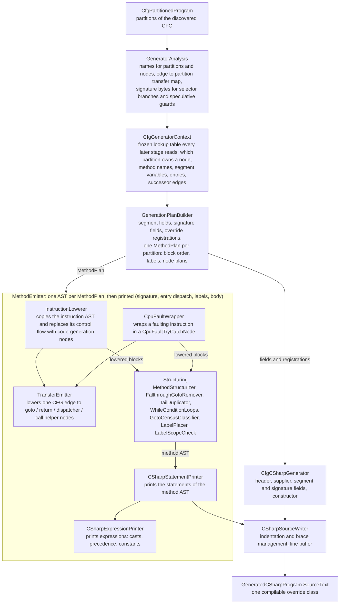

# C# Code Generator

Turns a discovered CFG (control flow graph) into a compilable C# override class that replaces the emulated assembly at runtime.

## What it does

After Spice86 runs a DOS program, it has a complete CFG of every instruction that executed. The generator takes that graph and produces a `.cs` file where each function partition becomes a C# method - gotos instead of jumps, method calls instead of `CALL`, typed register access instead of raw bytes.

## Pipeline overview

`CfgCSharpGenerator.Generate` runs these stages:



## Key concepts

### Partition = Method

The CFG is split into partitions (groups of blocks that form a logical function). Each partition becomes one C# method. Transfers between partitions become `return OtherMethod(loadOffset);`.

### Plan then write

The generator works in two phases:
1. **Plan** - decide everything up front (method order, labels, entry dispatch, segment fields)
2. **Write** - walk the plan and emit code mechanically, no re-analysis needed

The plan built by `GenerationPlanBuilder.Build` holds, per program: the segment fields, the override registrations and the signature fields (`SignatureFieldPlan`, one `private static readonly byte?[]` per instruction whose bytes are re-read at runtime). Per method (`MethodPlan`): a `PartitionBlockGraph` (`MethodPlan.BlockGraph`), a `DepthFirstOrdering<CfgBlock>` (`MethodPlan.BlockTraversal`), the block order, one `NodeEmissionPlan` per node (carrying `EmitsExternalEventCheck` and `EmitsExternalEventCheckAfter`), the label names and the local variable suffixes.

`MethodEmitter.Emit` then works over that plan like this:
1. build the method body without writing any text: the entry dispatch (`BuildEntryDispatch`) and one `InstructionBoundaryNode` per node (`BuildBoundary`), whose body is the event check, the speculative guard, the asm comment and the lowered instruction;
2. check the block graph agrees with the emitted boundaries (`BlockGraphGotoCheck`) and find the natural loops (`NaturalLoopForest.Build` over the retreating edges of the layout traversal);
3. structure the lowered blocks with `MethodStructurizer.Structure` twice - once without and once with loop exit placement - and keep the variant with fewer gotos, then remove the fallthrough gotos (`FallthroughGotoRemover.Remove`);
4. duplicate tiny diverging tails (`TailDuplicator.Apply`), classify the surviving gotos (`GotoCensusClassifier.Classify`), and turn `while (true)` loops whose first real statement is an exit test into `while (c)` loops (`WhileConditionLoops.Apply`);
5. collect the goto targets with `GotoTargetCollector` (every `GotoNode` target, and whether a `CyclicJumpNode` exists, in which case the `entrydispatcher:` label is written), insert a `LabelNode` before the nodes that are goto targets (`LabelPlacer.Place`), and verify every goto's label is in scope (`LabelScopeCheck.Verify`);
6. print the method with `CSharpStatementPrinter`.

`MethodEmitter` throws `InvalidOperationException` when the method body can still complete normally (`CompletesNormallyVisitor`), because such a body would fall off its end.

### Block layout

Blocks are emitted in reverse post-order of a depth-first traversal that starts at the primary entry block (`GenerationPlanBuilder.BuildMethodPlan`). Successors are visited non-fallthrough first, in descending address order, and the fallthrough successor last (`GenerationPlanBuilder.LayoutSuccessors`), so the fallthrough block is usually placed right after its predecessor and needs no `goto`. The primary entry is always the first emitted node, so a single-entry method needs no jump at its start.

### Structuring

`MethodStructurizer.Structure` nests the lowered blocks into loops, conditionals and switch sections. Every transfer is still an explicit `goto` when it runs; the nesting only decides where the `goto`s can fall through or become `break` / `continue`.

- **Natural loops** - `NaturalLoopForest` finds the loops from the back edges of the block graph (a back edge targets a block that dominates its source). Every loop header must start with `CheckExternalEvents`, or `Structure` throws. A loop a second entry reaches is not structurable and stays `goto`.
- **`do` / `while (true)` loops** - a loop whose only latch ends with a conditional jump back to the header (its other arm leaving the loop) becomes a `do { ... } while (c)`; any other loop becomes `while (true)` and leaves through `break`. Child loops nest inside their parent's body.
- **`if` without `else`** - when one arm of a forward branch can be nested and comes back to the other arm's target, it nests under the condition and the `goto` back disappears.
- **`if` / `else`** - when both arms can be nested and share one common join, they nest as `if / else` and the `goto` to the join disappears.
- **Guard clauses** - when an arm diverges (none of its blocks has an exit inside the method: every path ends with `return`, `throw` or a transfer out of the method), it nests and the other arm stays flat, so `if (c) { ...; return X(); }` reads as a guard instead of a `goto`. When both arms diverge, only the arm whose head is later in the layout is nested; the earlier one stays flat.
- **Jump table `case` nesting** - the arms of a near jump table are nested in their `case` sections instead of jumping away.
- **Loop exit placement** - `Structure` also runs with `placeLoopExits`, which moves the exit block a loop's `goto`s target the most (with every unplaced block it dominates) right after the loop, so the `goto`s to it become `break`s. The emitter keeps whichever variant prints fewer `goto`s.
- **Fallthrough cleanup** - `FallthroughGotoRemover.Remove` then deletes every `goto` that jumps where control goes anyway: a `goto` to the next statement, a `goto` to what follows a `switch` section or a loop (`break;`), a `goto` to the start of a `while (true)` body (`continue;`), and a `goto` after a statement that never completes (unreachable).
- **Tail duplication** - `TailDuplicator.Apply` pastes a small diverging block at each of its `goto`s: at most 3 instruction boundaries, no local variable, no `goto` of its own, never completes normally, no partition entry, not a loop header. Every `goto` to a kept block is replaced, and the block's original statements are deleted when the statement before them never completes normally.
- **`while (c)` loops** - `WhileConditionLoops.Apply` turns a `while (true)` whose body holds only event checks and comments before a `if (c) { break; }` into `while (!c)` with the test removed. The event check then runs after the test instead of before it - a maintainer decision for readability: the check no longer runs before the test that leaves the loop, and a `continue;` tests the condition before the check.
- **`else if` printing** - `CSharpStatementPrinter` prints an `else` whose only statement is an `if` as `else if (c) { ... }` (far call dispatch reads as one chain).
- **De Morgan** - `CodeGenerationAst.NegatedCondition` distributes `!` over `&&` / `||`, so a negated exit condition prints as `CX == 0 || !ZeroFlag` rather than `!(CX != 0 && ZeroFlag)`.

Branches the structurizer refuses (a condition that reads a local, an arm head outside the region or already placed or a loop header or a loop latch, arms that never meet, a shared target) and irreducible regions (a backward target that does not dominate its source) stay `goto`.

### Goto census

`GotoCensusClassifier.Classify` assigns every printed `goto` exactly one `GotoKeepReason` and the test runner appends one line per generated program (fixture) to `generated-code/goto-census.txt`. The tests assert `total == gotos`: the census explains every `goto` of the printed source.

| reason | the goto survives because |
|---|---|
| `entryDispatch` | it is a `goto` of the entry dispatch `switch (loadOffset)` |
| `cyclicJump` | it is the `goto entrydispatcher;` of a cyclic cross-partition jump |
| `targetIsEntry` | its target block holds a partition entry |
| `loopWithSecondEntry` | its target sits in a natural loop a second entry reaches |
| `loopRestart` | its target is the header of the innermost enclosing structured loop |
| `loopExit` | its target is outside the innermost enclosing structured loop |
| `irreducible` | its target comes earlier in the layout and does not dominate it |
| `conditionReadsLocals` | a refused branch: its condition reads a local variable |
| `otherArmNotGoto` | a refused branch: the other arm is not a single `goto` |
| `armOutsideRegion` | a refused branch: the arm's head is outside the region being structured |
| `armHeadPlaced` | a refused branch: the arm's head is already placed |
| `armHeadIsLoopHeader` | a refused branch: the arm's head is a loop header |
| `armHoldsLatch` | a refused branch: the arm holds a latch of the enclosing loop |
| `armNeverComesBack` | a refused branch: the arm could nest but does not come back to the other target, and the other arm cannot nest |
| `noSingleJoin` | a refused branch: both arms could nest but have no single common exit, or both come back |
| `switchSection` | a `switch` section that was not nested |
| `sharedTarget` | its target is the target of two or more printed `goto`s of the method |
| `notNextInLayout` | none of the above: a `goto` to a block that does not follow in the layout |

### Method AST

One method is one AST. Its leaves are the instruction ASTs: the same runtime nodes the interpreter and the JIT use (`BlockNode`, `IfElseNode`, `WhileNode`, registers, memory, ALU calls, ...). Everything that only generated code needs is a code-generation node in `CfgCodeGeneration/Ast/`, visited through `ICodeGenerationAstVisitor<T>`:

| node | what it is |
|---|---|
| `InstructionBoundaryNode` | one CFG node: its event check, speculative guard, asm comment and lowered body; carries the local-variable suffix |
| `GotoNode` / `LabelNode` | a same-method jump to a block entry, and its label; the label text is resolved when printing |
| `EntryDispatcherLabelNode` / `CyclicJumpNode` | the `entrydispatcher:` label, and the cyclic cross-partition re-entry that jumps to it |
| `SwitchNode` / `SwitchSection` / `BreakNode` | entry dispatch and near runtime dispatch; the printer never adds `break;`, `CodeGenerationAst.Section` does |
| `InfiniteLoopNode` / `DoWhileNode` / `ContinueNode` | a `while (true)` loop built from a natural loop, a `do { ... } while (c)` loop, and the `continue;` restarting the innermost enclosing loop; the runtime `WhileNode` also prints the `while (c)` loops `WhileConditionLoops` builds |
| `ReturnNode` | `return` of an `Action`: `NearRet()`, `Hlt()`, `OtherMethod(0x0010)`, ... |
| `CpuFaultTryCatchNode` / `CpuFaultHandler` | the `try/catch (CpuException)` of an instruction that faulted during discovery |
| `FailAsUntestedNode` / `UntestedMessagePart` | a `throw FailAsUntested(...)`; the holes of the message are expression nodes |
| `CheckExternalEventsNode`, `SpeculativeGuardNode`, `CommentNode`, `DivisionNode` | the helper calls and the comment of an instruction boundary, and the `Div16` / `IDiv16` tuple call |
| `SegmentVariableNode`, `OffsetLiteralNode`, `InstructionPointerNode`, `LoadOffsetParameterNode`, `MethodGroupNode`, `SignatureFieldNode`, `ExplicitCastNode` | expression leaves: `cs1`, `0x0010`, `IP`, `loadOffset`, a method group or a `_ => M(0x0004)` lambda, a `Signature_...` field, a cast |

Helper calls (`NearCall`, `InterruptCall`, `Callback`, `SelectorSignatureMatches`, ...) reuse the runtime `MethodCallNode` and `MethodCallValueNode`.

Completion rules (`CompletesNormallyVisitor`): a sequence follows its last statement; an `if` completes when one of its arms does; a `while` always completes; a `switch` completes when a section ends with `break` or its default completes; `return`, `goto`, `throw`, `FailAsUntested`, the cyclic jump and `break` never complete.

Rules for code that builds or walks the method AST:

- Lowered code is an `IVisitableAstNode`; "nothing" is an empty `BlockNode`. Build sequences with `CodeGenerationAst.Sequence`, which flattens nested `BlockNode`s, and test emptiness with `CodeGenerationAst.IsEmpty`.
- A lowered tree never contains runtime control-flow nodes (`JumpNearNode`, `CallNearNode`, `MoveIpNextNode`, ...). `CompletesNormallyVisitor` and `GotoTargetCollector` throw `InvalidOperationException` when they meet one.
- Instruction ASTs are shared with the interpreter and the JIT. A rewrite builds new nodes and never changes an existing one; returning an unchanged expression node is allowed because the nodes are immutable.
- A cast the generator adds is an `ExplicitCastNode`, which prints like `CSharpExpressionPrinter.Cast` and never folds constants. `TypeConversionNode` folds constants; it is only for conversions that come from the instruction AST.
- A new code-generation node is added to `ICodeGenerationAstVisitor<T>`, so every visitor (`CSharpExpressionPrinter`, `CompletesNormallyVisitor`, `GotoTargetCollector`) must decide what to do with it. `CSharpStatementPrinter` is a type switch: a new statement node needs its own case there.
- `CSharpStatementPrinter` and `CSharpExpressionPrinter` are the only producers of generated code text. No node holds generated code as a string; identifiers and comment text are not code.

### Edge lowering

Every jump/call/return in the original assembly becomes a "resolved CFG edge" - a source node, a target node, and metadata about what kind of transfer it is. The `TransferEmitter` turns each edge into the appropriate C# construct:

| Edge kind | Generated C# |
|-----------|-------------|
| Same method, next node | *(nothing - fallthrough)* |
| Same method, other node | `goto L_0009;` |
| Cross-partition | `return OtherMethod(0x0000);` |
| Cyclic cross-partition flow | `if (JumpDispatcher.Jump(unknown_F000_0025_F0025, 0x0000)) { loadOffset = JumpDispatcher.NextEntryAddress; goto entrydispatcher; }` then `return JumpDispatcher.RequiredJumpAsmReturn;` |
| Near/far call | `NearCall(cs1, 0x00CC, unknown_F000_0200_F0200);` / `FarCall(cs1, 0x000D, cs2, unknown_F100_0000_F1000);` plus the observed post-call continuation |
| Return | `return NearRet();` when the `ret` has no operand, `return NearRet(0x000A);` when it has one, `return FarRet();` for `retf` |

### Flags (Phase 2 rules)

The flag-related rewrites run before lowering, in `MethodEmitter.Emit`:

- **Flag liveness** - `FlagLiveness.Compute` works out which status flags each instruction still needs to write; every later decision reads it.
- **Condition fusion / recovery** - `ConditionFusionPlanner.Plan` finds, for each `jcc`, the nearest earlier node of its block that writes a flag the jump reads. When the instructions in between cannot change the outcome, it fuses the pair: the setter loses its ALU call and the jump tests the recovered relation (`a < b` instead of `CarryFlag`). `ConditionRecovery` rewrites the flag condition as a relation between the operands of the `cmp` / `test` before it, and E / NE / S / NS after an ALU operation as a test of the assigned result.
- **ALU expansion** - an instruction whose only work is one ALU call gets an expanded AST (`AluExpansionBuilder`, cleaned by `AluExpansionCleanup`) when at most one flag it writes is live after it and that flag has a readable form.
- **`AluAssignmentRewrite`** - on top of the expansion: a self-cancelling result (`x = x + 0`) disappears, a live flag reads in its readable form (`x < y` for carry), `x = x + 1` / `x = x - 1` print as `x++` / `x--`, and a `cmp` / `test` whose value no live flag needs is removed entirely.

Phase 4 is planned to replace these rules with a generic value propagation over the lowered code.

### External event checks

`CheckExternalEvents(cs, ip)` tells the emulator to deliver pending interrupts and advance emulated time. It is emitted in exactly three places:

1. at the entry of every method entry block; for an entry that sits in the middle of a block, inside its `switch (loadOffset)` case, before the `goto` (`MethodEmitter.BuildEntryDispatch` / `MethodEmitter.EntryEventCheck`);
2. at the entry of every block that is the target of a retreating edge of the layout traversal (loop heads), so every repeating path passes a check; when the structurizer gathers the blocks into a loop, this check is the first statement of the loop body;
3. after the body of an instruction that may enable interrupts (`sti`, `popf`, `popfd`), detected on the instruction AST by `InterruptEnableDetectorVisitor` (`sahf` does not count), unless its fallthrough block already checks at its entry.

The two flags that decide this are precomputed per node in `GenerationPlanBuilder.BuildMethodPlan` as `NodeEmissionPlan.EmitsExternalEventCheck` and `NodeEmissionPlan.EmitsExternalEventCheckAfter`. Straight-line code that has none of these three points gets no check, on purpose: emulated time only matters in loops.

Generated code never emits `State.InterruptShadowing`: the interpreter sets it so delivery waits one instruction after `sti`, but the generated `CheckExternalEvents` never reads it, so the assignment is dropped (`InstructionLowerer`). Known deviation: a pending interrupt is then delivered at the check right after `sti` / `popf` / `popfd`, one instruction earlier than a real CPU would deliver it.

### Helpers used by generated code

The generated class derives from `CSharpOverrideHelper`, which provides:

- `DispatchCpuFault(cpuException, cs, ip, [new CpuFaultTarget(...)])` in the `catch` of a faulting instruction;
- `Div8` / `Div16` / `Div32` / `IDiv8` / `IDiv16` / `IDiv32`, each returning `(Quotient, Remainder)`, for example `(AX, DX) = Div16(divisor: CX, dividend: ...);`;
- `In8` / `In16` / `In32` and `Out8` / `Out16` / `Out32` for port I/O;
- `SelectorSignatureMatches` and `VerifySpeculativeEntryOrFail`, which read the `Signature_...` fields;
- `FailAsUntested`, which throws on a path discovery never observed;
- `CheckExternalEvents`, the delivery point described above.

### Naming

Labels are `L_<offset>` (for example `L_0003`), unique per method; the node id is appended only when two nodes of the method share an offset (self-modifying code). Temps use the instruction offset as suffix, per method, with the same collision rule (for example `popDestinationCheck_0073`). Signature fields are `private static readonly byte?[] Signature_<offset>_<mnemonic>` (for example `Signature_0019_jne`), one per instruction, same collision rule. The mnemonic comes from `InstructionMnemonic`, and the collision rule itself is `DisambiguatedNames.Build`, called from `GenerationPlanBuilder` for labels and local suffixes and from `GeneratorAnalysis` for signature fields. Every `FailAsUntestedNode` comes from `UntestedMessages`, one method per kind: `Jump`, `ConditionalFallthrough`, `FallthroughAfter`, `IndirectWithoutTargets`, `NearTarget`, `FarTarget`, `CodeVariant`, `CallbackTarget`, `ReturnFromCall`, `EntryOffset`.

### Untested paths

If an edge was never traversed during discovery, the generated code throws `FailAsUntested(...)` at that point. This makes it safe to run the generated code: it either does exactly what was observed, or fails loudly on an unobserved path. Generated code expects speculative discovery to have filled the gaps: a conditional arm without a CFG edge fails as untested, and a `VerifySpeculativeEntryOrFail` guard re-reads the bytes of each speculative instruction before it runs.

A far call whose target was observed is dispatched on the remembered segment/offset pair: the generated code prints an `if` / `else if` chain over the observed targets (one `FarCall` per pair), the continuation is emitted once after the chain, and the final `else` fails as untested.

### CPU fault handling

Instructions that triggered a hardware exception (e.g. divide by zero) during discovery get wrapped in `try/catch(CpuException)`. The `catch` calls `DispatchCpuFault(cpuException, cs, ip, [new CpuFaultTarget(...)])`, which reads the live IVT, matches the handler, performs the fault entry sequence (push flags, push return address, clear interrupts, set CS/IP) and invokes the handler partition.

### Self-modifying code

Instructions at the same address with different bytes (self-modifying code) are handled through selector nodes. The generated code checks which byte signature currently matches memory and branches to the corresponding variant.

## Reusable analyses

Use these before writing a new traversal, graph or naming helper:

| type | location | what it gives |
|---|---|---|
| `PartitionBlockGraph` | `ControlFlowGraph/Analysis/` | blocks, entries, successors, predecessors and fallthrough successor of one partition |
| `DepthFirstOrdering<T>` and `GraphEdge<T>` | `Graph/` | post-order, reverse post-order and retreating edges for any successor function |
| `CodeGenerationAst`, `CompletesNormallyVisitor`, `GotoTargetCollector` | `CfgCodeGeneration/Ast/` | statement sequences and switch sections, completion analysis and goto targets of a lowered tree |
| `InterruptEnableDetectorVisitor` / `StatementPredicateVisitor` | `CPU/CfgCpu/Ast/Visitor/` | boolean predicates over an instruction AST, searching statement containers recursively |
| `DisambiguatedNames` and `InstructionMnemonic` | `CfgCodeGeneration/Naming/` | collision-free names from a base name plus a suffix; an instruction mnemonic as an identifier token |

The dependency rule is `CfgCodeGeneration -> ControlFlowGraph.Analysis -> Graph`, never the other way: nothing under `Graph` or `ControlFlowGraph.Analysis` may reference `MethodPlan`, `NodeEmissionPlan` or anything else under `CfgCodeGeneration`.

## File layout

```
CfgCodeGeneration/
|-- AluAssignmentRewrite.cs         rewrites a one-ALU-call instruction as plain code (see "Flags (Phase 2 rules)")
|-- BlockGraphGotoCheck.cs          checks the emitted boundaries match the block graph's edges
|-- CfgCSharpDumper.cs              writes the generated override file to the recording directory
|-- CfgCSharpGenerator.cs           top-level orchestrator: analyze -> plan -> build method ASTs -> print
|-- CfgGeneratorContext.cs          frozen lookup table shared by every stage
|-- CpuFaultWrapper.cs              wraps a faulting instruction in a CpuFaultTryCatchNode
|-- CSharpExpressionPrinter.cs      prints expression nodes as C# fragments: casts, precedence, constants
|-- CSharpSourceWriter.cs           indentation, braces and line buffer
|-- CSharpStatementPrinter.cs       prints a method AST as C# statements
|-- DivisionPattern.cs              recognizes the DIV/IDIV statement pattern and carries its operands
|-- GeneratedProjectScaffolder.cs   csproj + Program.cs scaffold for a runnable project
|-- GenerationPlanBuilder.cs        builds the plan (fields, registrations, per-method plans)
|-- GeneratorAnalysis.cs            first pass: names, transfers, signature bytes
|-- InstructionLowerer.cs           lowers an instruction AST; control flow becomes code-generation nodes
|-- MethodEmitter.cs                builds one AST per method, then prints it
|-- RepCompareLoopPattern.cs        recognizes the REP CMPS/SCAS loop pattern
|-- TransferEmitter.cs              lowers one CFG edge to goto / return / dispatcher / call nodes
|-- UntestedMessages.cs             the FailAsUntested nodes, one per untested situation
|-- Ast/
|   |-- ICodeGenerationAstVisitor.cs    visitor over runtime and code-generation nodes
|   |-- CodeGenerationNode.cs           the Accept rule shared by the code-generation nodes
|   |-- CodeGenerationAst.cs            Sequence / Empty / IsEmpty / Section helpers, NegatedCondition
|   |-- CompletesNormallyVisitor.cs     completion analysis of a lowered tree
|   |-- FallthroughGotoRemover.cs       deletes gotos that jump where control goes anyway
|   |-- GotoTargetCollector.cs          goto targets of a lowered tree
|   |-- GotoTargets.cs                  target labels + entry dispatcher flag
|   |-- LabelPlacer.cs                  puts one LabelNode before the statement each goto target starts at
|   |-- LabelScopeCheck.cs              verifies every goto's label is visible where the goto prints
|   |-- LoopExits.cs                    whether a statement holds a break / continue an inner construct would capture
|   |-- TailDuplicator.cs               pastes a small diverging block at each of its gotos
|   |-- WhileConditionLoops.cs          turns a while (true) with an exit test first into while (c)
|   `-- *Node.cs, SwitchSection.cs, CpuFaultHandler.cs, UntestedMessagePart.cs
|                                       the code-generation nodes (see "Method AST")
|-- Structuring/
|   |-- MethodStructurizer.cs       nests the lowered blocks into loops, ifs and switch sections
|   |-- LoweredBlock.cs             the contiguous boundaries of one CFG block, in layout order
|   |-- GotoCensusClassifier.cs     one GotoKeepReason per printed goto
|   |-- GotoCensus.cs               the per-method goto counts
|   `-- GotoKeepReason.cs           why a goto survives structuring (see "Goto census")
|-- Conditions/
|   |-- ConditionFusionPlanner.cs   fuses a jcc with the setter of the flags it reads
|   |-- ConditionFusion.cs          the fused execution AST per node
|   `-- ConditionRecovery.cs        a flag condition as a relation between the setter's operands
|-- Liveness/
|   |-- FlagLiveness.cs             the status flags live after each instruction
|   |-- InstructionFlagFactsBuilder.cs  per-instruction flag reads and writes
|   `-- InstructionFlagFacts.cs     the flag facts of one instruction
|-- Model/
|   |-- CallContinuation.cs         expected return address + observed post-call edge
|   |-- CSharpFragment.cs           a printed expression with its type and precedence
|   |-- GeneratedCSharpProgram.cs   the produced source text
|   |-- GeneratedOverrideNames.cs   namespace, class and file names baked into the output
|   |-- ResolvedCfgEdge.cs          a source/target edge with its successor kind
|   `-- Plan/
|       |-- GenerationPlan.cs       segment fields, signature fields, registrations, methods
|       |-- MethodPlan.cs           one method: blocks, nodes, labels, traversal, entry dispatch
|       |-- NodeEmissionPlan.cs     per-node emission decisions
|       |-- OverrideRegistration.cs one DefineFunctionWithoutInterpreterFallback registration
|       |-- SegmentFieldPlan.cs     one segment field declaration
|       `-- SignatureFieldPlan.cs   one byte?[] signature field
`-- Naming/
    |-- DisambiguatedNames.cs       base name + suffix disambiguation
    `-- InstructionMnemonic.cs      instruction mnemonic as an identifier token
```
